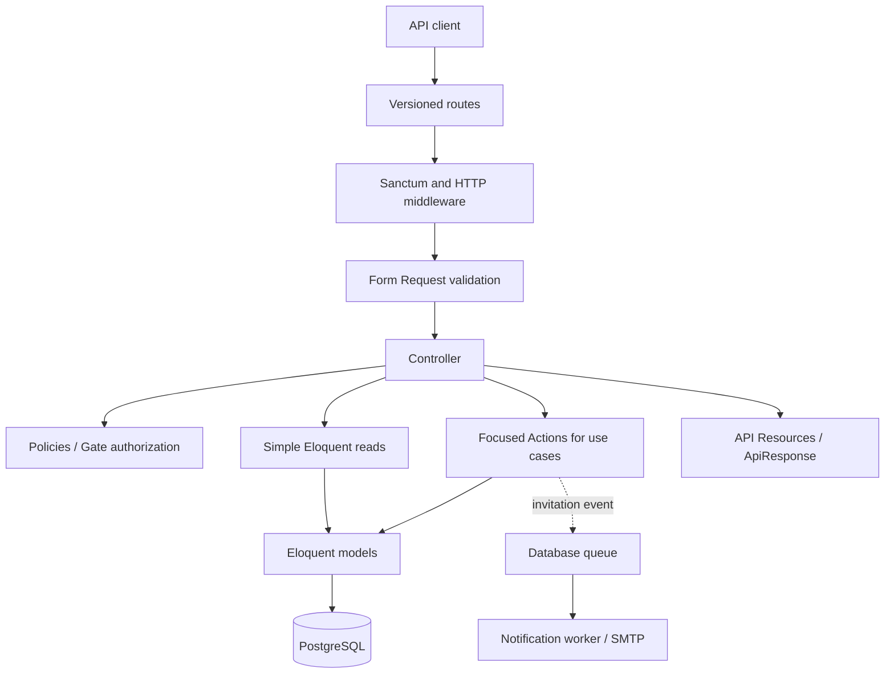
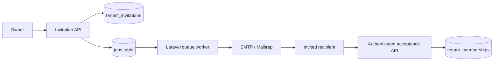

# SupportHub

**A multi-tenant helpdesk REST API built with Laravel 13, PostgreSQL, Sanctum, Pest, and Laravel Queues.**

SupportHub is an API-first portfolio project for managing company workspaces, support-team memberships, and (soon) support tickets with **real-time internal conversations**. Its focus is secure tenant isolation, role-based authorization, database consistency, asynchronous processing, and maintainable Laravel architecture.

> [!IMPORTANT]
> **Status: Active development — Identity complete; Tenancy invitation workflow implemented; membership administration and Tickets still in progress.**
> This is a learning/portfolio backend, not a production-ready commercial SaaS. Features listed as *Planned* below are not implemented yet.

## Contents

- [Progress and scope](#progress-and-scope)
- [Technology](#technology)
- [Architecture](#architecture)
- [Getting started](#getting-started)
- [API endpoints](#api-endpoints)
- [Multi-tenancy and security](#multi-tenancy-and-security)
- [Queued invitation emails](#queued-invitation-emails)
- [Testing](#testing)
- [Project structure](#project-structure)
- [Roadmap](#roadmap)
- [Contributing and development](#contributing-and-development)
- [License](#license)

## Progress and scope

| Area | Status | Current / intended behavior |
| --- | --- | --- |
| API foundation | **Implemented** | Versioned `/api/v1` routes, health check, consistent JSON success/error responses |
| Identity | **Implemented** | Registration, login, authenticated user, logout, Sanctum bearer tokens |
| Tenant workspaces | **Implemented** | Create, list, and view tenants; creator becomes active Owner |
| Tenant isolation | **Implemented for existing endpoints** | Active membership checks; members cannot read other tenants' details or member lists |
| Membership listing | **Implemented** | Active members can list their tenant's members and statuses |
| Invitations | **Implemented** | Owner-only invitation creation, hashed single-use tokens, 7-day expiry, queued email, authenticated acceptance |
| Membership administration | **Planned — next** | Owner/Admin/Agent permissions, role changes, suspension/reactivation, member removal, last-owner protection |
| Ticket management | **Planned** | Tenant-scoped ticket CRUD, priority, status changes, and agent assignment |
| Ticket conversations | **Planned** | Persisted *internal staff* messages, message history, and secure tenant-scoped access |
| Real-time chat | **Planned** | Laravel Reverb, Broadcasting, Echo, and private WebSocket channels for ticket messages |
| Portfolio readiness | **Planned** | Final security tests, API documentation, CI, and deployment where practical |

**Deliberately out of scope for this MVP:** Stripe/subscription billing, a customer portal, customer-visible chat, a separate contacts module, file attachments, SLA automation, analytics dashboards, and a full frontend. The project remains **API-first**; a minimal JavaScript client may be used to demonstrate WebSockets.

### What works today

- Users register with normalized email addresses and securely hashed passwords, log in, inspect their profile, and revoke their current Sanctum token.
- An authenticated user creates a tenant and becomes its active Owner in a single database transaction.
- Active members can list their tenants and view their tenant and membership information; suspended users and outsiders are denied where appropriate.
- Active Owners can invite an Agent by email. SupportHub prevents duplicate active invitations and invitations to existing members.
- Invitation tokens are generated securely, stored as hashes, expire after seven days, and are consumed once. The recipient must log in with the invited email to accept.
- Invitation notifications are queued for background delivery (currently exercised with a database queue and SMTP/Mailtrap).

## Technology

| Concern | Technology |
| --- | --- |
| Language | PHP 8.5 (project development environment) |
| Framework | Laravel 13 |
| Database | PostgreSQL |
| Authentication | Laravel Sanctum |
| API tests | Pest + Laravel HTTP testing |
| Background processing | Laravel Queues (PostgreSQL database driver) |
| Email testing | Mailtrap SMTP or Laravel `log` mailer |
| Real-time messaging (planned) | Laravel Reverb, Broadcasting, Laravel Echo, WebSockets |
| Code formatting | Laravel Pint |
| Architecture | Feature-Based Modular Monolith with pragmatic application layers |

See [`composer.json`](composer.json) and [`package.json`](package.json) for exact installed dependencies and version constraints. The Laravel starter may include Vite/Tailwind tooling, but a product frontend is not part of this API MVP.

## Architecture

SupportHub runs as **one Laravel application backed by one PostgreSQL database**. Features are organized by business capability under `app/Modules`, rather than splitting the system into microservices.



**Module responsibilities**

- **Identity:** Global user accounts, authentication, token issuance and revocation.
- **Tenancy:** Company workspaces, memberships, RBAC, secure invitations, and invitation notifications.
- **Tickets (planned):** Tickets, assignments, status transitions, internal messages, and broadcasting.
- **Shared:** Cross-cutting API response formatting and exception handling.

We use **Actions** for meaningful state-changing use cases (especially those requiring transactions), **Policies** for authorization, **API Resources** for response shapes, and **Eloquent** for persistence and straightforward reads. Query classes or services will be added only when complexity warrants them; there is no mandatory Repository layer.

## Getting started

### Requirements

- PHP compatible with the project's `composer.json` (development uses PHP 8.5)
- Composer
- PostgreSQL and a database user able to run migrations
- Git
- Node.js/npm only if you need the starter Vite assets

### 1. Clone and install

```bash
git clone git@github.com:fathallah7/multi-tenant-helpdesk-saas.git
cd multi-tenant-helpdesk-saas
composer install
cp .env.example .env
php artisan key:generate
```

Use the HTTPS clone URL if SSH is not configured.

### 2. Configure PostgreSQL and queues

Set values in your local `.env` (replace placeholders; never commit real credentials):

```dotenv
APP_NAME=SupportHub
APP_ENV=local
APP_DEBUG=true
APP_URL=http://localhost:8000

DB_CONNECTION=pgsql
DB_HOST=127.0.0.1
DB_PORT=5432
DB_DATABASE=supporthub
DB_USERNAME=your_postgres_user
DB_PASSWORD=your_local_password

QUEUE_CONNECTION=database
MAIL_MAILER=log
SUPPORTHUB_FRONTEND_URL=http://localhost:3000
```

`SUPPORTHUB_FRONTEND_URL` is a placeholder for invitation acceptance links. Since the MVP is API-only, you can copy the token from a development email into the acceptance API request; a full frontend acceptance page is not implemented.

For Mailtrap, replace the `log` mailer with `smtp` and configure `MAIL_HOST`, `MAIL_PORT`, `MAIL_USERNAME`, `MAIL_PASSWORD`, and sender details using **your own** sandbox credentials. SMTP credentials must stay in `.env`.

### 3. Migrate and run

```bash
php artisan migrate
php artisan serve
```

The database queue requires the `jobs` table (included in the project's migrations). In a separate terminal:

```bash
php artisan queue:work database --queue=default
```

If you edit queue configuration while workers are running, restart the workers. You can also build the optional starter assets with `npm install && npm run build`.

### 4. Run the tests

Use a **separate PostgreSQL test database** configured in the project's test settings. Never run database-refreshing tests against development or production data.

```bash
php artisan test
```

## API endpoints

Current endpoints use the `/api/v1` prefix. Protected routes expect `Authorization: Bearer <SANCTUM_TOKEN>`.

| Method | Route | Access | Description |
| --- | --- | --- | --- |
| `GET` | `/api/v1/health` | Public | Health check |
| `POST` | `/api/v1/auth/register` | Public | Register and issue access token |
| `POST` | `/api/v1/auth/login` | Public | Authenticate and issue access token |
| `GET` | `/api/v1/auth/me` | Authenticated | Current user |
| `POST` | `/api/v1/auth/logout` | Authenticated | Revoke current token |
| `POST` | `/api/v1/tenants` | Authenticated | Create tenant with Owner membership |
| `GET` | `/api/v1/tenants` | Authenticated | List tenants with active memberships |
| `GET` | `/api/v1/tenants/{tenant}` | Active tenant member | View tenant |
| `GET` | `/api/v1/tenants/{tenant}/members` | Active tenant member | List tenant memberships |
| `POST` | `/api/v1/tenants/{tenant}/invitations` | Active tenant Owner | Invite an Agent |
| `POST` | `/api/v1/invitations/accept` | Authenticated invitee | Accept invitation with token |

### Response format

SupportHub consistently uses an envelope like:

```json
{
  "success": true,
  "message": "Tenant retrieved successfully.",
  "data": {
    "id": 1,
    "name": "Acme Support",
    "slug": "acme-support"
  },
  "errors": null
}
```

Failed requests use `success: false`, an appropriate HTTP status, `data: null`, and validation details under `errors` when applicable.

### Example: Create a tenant

```bash
curl -X POST http://localhost:8000/api/v1/tenants \
  -H 'Accept: application/json' \
  -H 'Content-Type: application/json' \
  -H "Authorization: Bearer YOUR_SANCTUM_TOKEN" \
  -d '{"name":"Acme Support","slug":"acme-support"}'
```

### Example: Invite an agent

```bash
curl -X POST http://localhost:8000/api/v1/tenants/1/invitations \
  -H 'Accept: application/json' \
  -H 'Content-Type: application/json' \
  -H "Authorization: Bearer YOUR_OWNER_TOKEN" \
  -d '{"email":"agent@example.com"}'
```

After the invitee registers or signs in with the same email address, they accept using their own bearer token:

```bash
curl -X POST http://localhost:8000/api/v1/invitations/accept \
  -H 'Accept: application/json' \
  -H 'Content-Type: application/json' \
  -H "Authorization: Bearer YOUR_INVITEE_TOKEN" \
  -d '{"token":"INVITATION_TOKEN_FROM_EMAIL"}'
```

The invitation token is **never returned by the invitation creation API**. Do not share real tokens or include them in screenshots, public logs, issues, or commits.

## Multi-tenancy and security

SupportHub uses a **shared PostgreSQL database and schema** with tenant-scoped access control.

- `users` are global identities: the same account can join multiple companies.
- `tenants` are company workspaces.
- `tenant_memberships` connect users and tenants, with tenant-specific roles/statuses.
- `tenant_invitations` store the invited email, role, inviter, token hash, expiration, and acceptance/revocation timestamps.
- The implemented access rules use active memberships, explicit tenant filters, and Laravel Policies; knowing another tenant's ID must not grant access.
- Invitation acceptance checks token validity, expiration, single use, and the authenticated recipient's email, then creates membership and marks acceptance in a single transaction.
- The planned ticket APIs and WebSocket private channels will enforce **the same tenant boundary**, including agent permissions.

**Current role behavior:** Owner and Agent flows are exercised; an expanded Owner/Admin/Agent permission model, role-change operations, and suspension/reactivation administration are on the roadmap. Existing membership status checks already deny suspended members access to protected tenant views.

## Queued invitation emails

Invitation notifications implement Laravel's `ShouldQueue` (and encrypted queue payload handling), allowing the HTTP API to return without waiting for SMTP delivery. Notification dispatch is deferred until the invitation transaction commits.



For local debugging, stop the worker, create an invitation with a new email, and inspect pending jobs. Then run `php artisan queue:work database --once -v`. With `MAIL_MAILER=log`, rendered emails appear in `storage/logs/laravel.log`; use a private Mailtrap inbox for SMTP testing.

## Testing

SupportHub uses **Pest feature tests with PostgreSQL**. The current suite includes tests for:

- Identity registration, login, logout, and token access.
- Consistent API errors and health checks.
- Tenant creation, relationships, listing, and active-member authorization.
- Tenant member listing, outsider denial, and suspended-member denial.
- Invitation creation, duplicate prevention, owner-only access, and notification dispatch with `Notification::fake()`.
- Invitation acceptance: valid, reused, expired, revoked, wrong-account, existing-member, and unauthenticated cases.

```bash
# Full suite
php artisan test

# Focused examples
php artisan test tests/Feature/Tenancy/TenantInvitationTest.php
php artisan test tests/Feature/Tenancy/AcceptTenantInvitationTest.php
```

`Notification::fake()` verifies application intent, not worker execution. The database queue and SMTP path are additionally checked manually. The full test suite should be run after the latest changes before merging or publishing; a successful run is not claimed here.

**Test principle:** Verify meaningful business and security behavior, especially cross-tenant access, invalid credentials/tokens, concurrency-sensitive state changes, and authorization rules.

## Project structure

```text
app/
├── Models/
│   └── User.php
├── Modules/
│   ├── Identity/
│   │   ├── Actions/
│   │   └── Http/{Controllers,Requests,Resources}/
│   └── Tenancy/
│       ├── Actions/
│       ├── Enums/
│       ├── Http/{Controllers,Requests,Resources}/
│       ├── Models/
│       ├── Notifications/
│       └── Policies/
└── Shared/Http/{Exceptions,Responses}/

database/migrations/
tests/Feature/{Identity,Tenancy,Shared}/
```

A **Tickets** module will be added for ticket management, internal messages, and real-time broadcasts. The exact folder structure may evolve as those features are implemented.

## Roadmap

The remaining scope is deliberately short so this can become a **finished, demonstrable portfolio API** instead of an ever-expanding commercial SaaS.

- [x] Project foundation: Laravel, PostgreSQL, response/error conventions, Pest.
- [x] Identity: registration, login, current user, and Sanctum logout.
- [x] Tenants: create/list/show, owner membership, tenant policies and isolation tests.
- [x] Membership listing and invitation creation with queued email delivery.
- [x] Secure invitation acceptance and focused creation/acceptance tests added.
- [ ] **Finish membership administration:** Owner/Admin/Agent permissions, role changes, suspend/reactivate, remove, last active Owner safeguards.
- [ ] **Tickets:** tenant-scoped CRUD, priority, assignment, status changes, focused tests.
- [ ] **Internal ticket conversation:** stored staff messages, message history/pagination, per-ticket authorization.
- [ ] **Real-time delivery:** Laravel Reverb, private tenant/ticket broadcast channels, Echo and a minimal demo client.

### Future ideas (not MVP commitments)

Customer portal and external replies, contact management, attachments, billing/subscriptions, search/analytics, SLAs, typing indicators, read receipts, and richer monitoring.

## Contributing and development

A focused workflow is preferred:

1. Keep changes within the relevant feature module.
2. Write targeted Pest tests for new business behavior and regressions.
3. Run the full suite and `vendor/bin/pint --dirty` before merging.
4. Update API documentation/README when behavior changes.
5. Never commit `.env`, SMTP/API credentials, invitation tokens, access tokens, or real customer data. Report potential security issues privately.

## License

See [`composer.json`](composer.json) and the repository's license file, if present, for the licensing terms.
