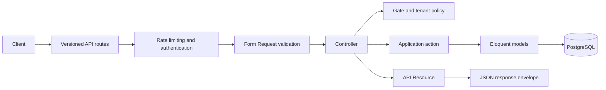

# SupportHub

SupportHub is an API-first, multi-tenant helpdesk SaaS built with Laravel. It
is designed for companies that need isolated workspaces, support-team access,
customer tickets, conversations, and subscription billing in one application.

> [!IMPORTANT]
> SupportHub is under active development. Authentication and the tenancy
> foundation are implemented; ticketing, conversations, and billing are still
> planned. The application is not production-ready.

## Contents

- [Current capabilities](#current-capabilities)
- [Technology](#technology)
- [Architecture](#architecture)
- [Getting started](#getting-started)
- [API](#api)
- [Multi-tenancy](#multi-tenancy)
- [Testing](#testing)
- [Development workflow](#development-workflow)
- [Project structure](#project-structure)
- [Roadmap](#roadmap)
- [Documentation](#documentation)
- [Contributing](#contributing)
- [License](#license)

## Current capabilities

| Area | Status | Available behavior |
| --- | --- | --- |
| API foundation | Implemented | `/api/v1` routes, health check, consistent JSON responses and errors |
| Identity | Implemented | Registration, login, current-user lookup, logout, and Sanctum tokens |
| Tenancy | In progress | Tenant creation, listing and detail, member listing, roles, statuses, and invitations |
| Tenant authorization | In progress | Active membership required to view tenants and members; only active owners can invite |
| Tickets | Planned | Creation, assignment, priority, status transitions, and audit history |
| Conversations | Planned | Customer-visible replies, internal notes, and attachments |
| Billing | Planned | Tenant subscriptions, entitlements, and verified webhooks |
| Notifications | In progress | Queued, encrypted invitation email; ticket and billing notifications are planned |
| Product UI | Not started | The repository currently exposes a JSON API and a Vite/Tailwind scaffold |

Implemented identity behavior includes:

- Registration with normalized email addresses and a minimum 12-character
  password.
- Login with rate limiting and credential verification.
- Laravel Sanctum bearer tokens that expire after 30 days.
- Authenticated `/me` access.
- Logout by revoking the current access token.

Creating a tenant and its initial active `owner` membership occurs in one
database transaction. Active members can view their tenant and its member list.
Active owners can invite an `agent`; the invitee must sign in with the invited
email to accept the seven-day, single-use invitation.

## Technology

| Area | Technology |
| --- | --- |
| Runtime | PHP 8.3+; currently developed on PHP 8.5 |
| Framework | Laravel 13 |
| Database | PostgreSQL |
| Authentication | Laravel Sanctum 4 |
| Tests | Pest 5 with Laravel's testing utilities |
| Frontend tooling | Vite 8 and Tailwind CSS 4 |
| Code style | Laravel Pint |
| Architecture | Modular monolith |

Exact package constraints are defined in
[`composer.json`](composer.json) and [`package.json`](package.json).

## Architecture

SupportHub is a modular monolith: one Laravel application and one PostgreSQL
database, with business capabilities separated under `app/Modules`.



The main boundaries are:

- `Identity` owns users, authentication, and token issuance.
- `Tenancy` owns workspaces, memberships, tenant roles, invitations, and their
  email notification.
- `Shared` owns cross-cutting HTTP response and exception handling only.
- Planned modules will own contacts, tickets, conversations, billing, and
  broader notifications.

Controllers remain thin. Form Requests validate input, actions coordinate
business operations, Eloquent models handle persistence relationships, and API
Resources define public representations. New abstractions are introduced only
when a concrete use case requires them.

## Getting started

### Requirements

- PHP 8.3 or newer
- Composer
- PostgreSQL
- Node.js and npm
- Git

### 1. Clone the repository

```bash
git clone git@github.com:fathallah7/multi-tenant-helpdesk-saas.git
cd multi-tenant-helpdesk-saas
```

Use the repository's HTTPS clone URL instead if SSH access is not configured.

### 2. Install dependencies

```bash
composer install
npm install
```

### 3. Create the environment file

```bash
cp .env.example .env
php artisan key:generate
```

The starter `.env.example` defaults to SQLite. Change it to PostgreSQL before
running migrations:

```dotenv
APP_NAME="SupportHub"
APP_ENV=local
APP_DEBUG=true

DB_CONNECTION=pgsql
DB_HOST=127.0.0.1
DB_PORT=5432
DB_DATABASE=supporthub
DB_USERNAME=postgres
DB_PASSWORD=your-local-password
```

Create the configured database and use a database role with permission to
create tables, indexes, foreign keys, and check constraints.

### 4. Prepare the application

```bash
php artisan migrate
npm run build
```

Seeders do not currently provide application data, so `php artisan db:seed` is
not required.

### 5. Start development services

```bash
composer run dev
```

This runs the Laravel development server, queue listener, application log
viewer, and Vite development server together. Press `Ctrl+C` to stop them.

Invitation emails use the queue. Set `SUPPORTHUB_FRONTEND_URL` to the frontend
base URL for acceptance links; it defaults to `http://localhost:3000`.
The starter environment logs outgoing mail, so configure a mail transport to
deliver invitations to real inboxes.

For API-only work, the Laravel server can be started separately:

```bash
php artisan serve
```

### Optional setup script

After `.env` exists and contains a working PostgreSQL connection, this command
can install dependencies, generate the application key, migrate, and build
assets:

```bash
composer run setup
```

## API

All application API routes use the `/api/v1` prefix.

### Endpoints

| Method | Endpoint | Authentication | Description |
| --- | --- | --- | --- |
| `GET` | `/api/v1/health` | None | API health check |
| `POST` | `/api/v1/auth/register` | None | Register a user and issue a token |
| `POST` | `/api/v1/auth/login` | None | Authenticate and issue a token |
| `GET` | `/api/v1/auth/me` | Bearer token | Return the authenticated user |
| `POST` | `/api/v1/auth/logout` | Bearer token | Revoke the current token |
| `GET` | `/api/v1/tenants` | Bearer token | List tenants with active memberships and the caller's role |
| `POST` | `/api/v1/tenants` | Bearer token | Create a tenant and owner membership |
| `GET` | `/api/v1/tenants/{tenant}` | Bearer token; active member | Return a tenant |
| `GET` | `/api/v1/tenants/{tenant}/members` | Bearer token; active member | List tenant memberships, including suspended members |
| `POST` | `/api/v1/tenants/{tenant}/invitations` | Bearer token; active owner | Invite an agent by email |
| `POST` | `/api/v1/invitations/accept` | Bearer token; invited email | Accept an invitation |

Registration and login are limited to five requests per minute per Laravel's
configured throttle middleware. Invitation creation is limited to ten requests
per minute.

### Response envelope

Successful and failed API responses use the same top-level keys:

```json
{
    "success": true,
    "message": "SupportHub API is running.",
    "data": {
        "status": "healthy"
    },
    "errors": null
}
```

Errors set `success` to `false`, set `data` to `null`, and return an appropriate
HTTP status. Validation details are returned in `errors`.

### Register

```bash
curl --request POST "$API_BASE_URL/auth/register" \
    --header 'Accept: application/json' \
    --header 'Content-Type: application/json' \
    --data '{
        "name": "Ada Lovelace",
        "email": "ada@example.com",
        "password": "correct-horse-battery-staple",
        "password_confirmation": "correct-horse-battery-staple"
    }'
```

Set `API_BASE_URL` to the configured application URL followed by `/api/v1`.
Registration returns the user, a Sanctum bearer token, and the token type.

### Login

```bash
curl --request POST "$API_BASE_URL/auth/login" \
    --header 'Accept: application/json' \
    --header 'Content-Type: application/json' \
    --data '{
        "email": "ada@example.com",
        "password": "correct-horse-battery-staple"
    }'
```

### Create a tenant

```bash
curl --request POST "$API_BASE_URL/tenants" \
    --header 'Accept: application/json' \
    --header 'Content-Type: application/json' \
    --header "Authorization: Bearer $SUPPORTHUB_TOKEN" \
    --data '{
        "name": "Acme Support",
        "slug": "acme-support"
    }'
```

Tenant slugs must be unique and contain lowercase letters, numbers, and single
hyphens between segments.

### View tenants and members

`GET /api/v1/tenants` lists only workspaces where the caller has an active
membership and includes their role. An active `owner`, `admin`, or `agent` can
retrieve the tenant and its member list. The member list includes each user's
name and email, role, and membership status. Suspended members cannot access
these endpoints.

### Invite and accept a member

An active owner can send `POST /api/v1/tenants/{tenant}/invitations` with an
`email`. The address is trimmed and lowercased. Existing members and duplicate
unexpired invitations are rejected with `422`. A successful `201` response
contains the invitation ID, email, `agent` role, and expiry. The token is sent
only in the queued email link and is never returned by the API.

The invitee registers or signs in with that email, then sends the token from
the link to `POST /api/v1/invitations/accept`. Acceptance creates an active
membership and marks the invitation used in one transaction. Expired, revoked,
used, and invalid invitations return `422`; a different signed-in account
receives `403`.

Do not commit real access tokens or place them in shell history, logs, or API
examples.

## Multi-tenancy

SupportHub uses a shared PostgreSQL database and schema.

- `users` stores global login identities.
- `tenants` stores company workspaces.
- `tenant_memberships` connects users to tenants.
- `tenant_invitations` stores the invited email, role, token hash, inviter,
  expiry, and acceptance or revocation timestamps.
- A user may belong to multiple tenants with a different role in each.
- Membership roles are `owner`, `admin`, and `agent`.
- Membership statuses are `active` and `suspended`.

Tenant-owned records carry `tenant_id`. Existing tenant views and invitations
use active-membership policies; access must never rely on a request-supplied
tenant ID alone. Future features also need tenant-scoped queries, database
constraints, authorization, and cross-tenant tests.

Customers will be modeled as tenant-scoped contacts rather than support-team
memberships.

## Testing

The test suite uses Pest and PostgreSQL. A separate testing database is
mandatory because feature tests may migrate or refresh it.

Create the database configured by `DB_DATABASE` in [`phpunit.xml`](phpunit.xml)
and ensure the local PostgreSQL credentials can access it. Never point the test
configuration at development, staging, or production data.

Run the complete suite:

```bash
php artisan test --compact
```

Run a focused file while developing:

```bash
php artisan test --compact tests/Feature/Identity/LoginTest.php
```

Run a single test by name:

```bash
php artisan test --compact --filter='user can log in'
```

The current suite covers:

- Health and unknown API routes.
- Registration validation and token creation.
- Login success, invalid credentials, and throttling.
- Authenticated-user retrieval and unauthenticated access.
- Current-token revocation on logout.
- Tenant membership relationships and multi-tenant membership.
- Tenant creation, active-membership listing, tenant views, and member access.
- Invitation permissions, validation, duplicate prevention, and acceptance
  rules.

Every tenant-owned feature must add tests proving that a user from one tenant
cannot read or modify another tenant's data.

## Development workflow

### Before changing code

1. Check the relevant module and sibling files for existing conventions.
2. Confirm installed package versions before using version-specific APIs.
3. Add or update the narrowest meaningful Pest tests.
4. Keep changes within an existing module unless a new business capability
   clearly requires a new one.

### Useful commands

```bash
# Inspect application routes
php artisan route:list --except-vendor

# Run a focused test file
php artisan test --compact tests/Feature/Identity/LoginTest.php

# Format changed PHP files
vendor/bin/pint --dirty --format agent

# Build production frontend assets
npm run build
```

### Code conventions

- Use strict, descriptive types and explicit return types.
- Use Form Requests for HTTP validation.
- Use API Resources for public response representations.
- Keep controllers focused on HTTP coordination.
- Use actions for multi-step use cases and transactions.
- Use PHP backed enums for stable application values.
- Preserve tenant integrity with authorization, scoped queries, and database
  constraints.
- Prefer Eloquent and Laravel conventions over unnecessary repositories or
  infrastructure layers.
- Create new migrations for schema changes after a migration has been shared or
  applied.
- Never commit `.env`, credentials, access tokens, or production data.

## Project structure

```text
app/
├── Models/
│   └── User.php
├── Modules/
│   ├── Identity/
│   │   ├── Actions/
│   │   ├── Http/
│   │   │   ├── Controllers/
│   │   │   ├── Requests/
│   │   │   └── Resources/
│   │   └── Routes/
│   └── Tenancy/
│       ├── Actions/
│       ├── Enums/
│       ├── Http/
│       ├── Models/
│       ├── Notifications/
│       ├── Policies/
│       └── Routes/
└── Shared/
    └── Http/
        ├── Exceptions/
        └── Responses/

database/
├── factories/
├── migrations/
└── seeders/

docs/
├── architecture/
└── database/

routes/
└── api.php

tests/
├── Feature/
│   ├── Identity/
│   ├── Shared/
│   └── Tenancy/
└── Unit/
```

Each module owns its routes and business behavior. The root API route file
assembles module routes under `/api/v1`.

## Roadmap

The expected delivery order follows feature dependencies:

1. Complete tenant context, remaining member management, and isolation tests.
2. Add tenant-scoped customer contacts.
3. Implement ticket creation, listing, assignment, and status transitions.
4. Add public replies, internal notes, attachments, and ticket history.
5. Select a billing provider and implement subscriptions and entitlements.
6. Add ticket and billing notifications, operational monitoring, and deployment
   configuration.
7. Complete security, performance, and production-readiness reviews.

Optional features such as tags, read receipts, realtime presence, and in-app
notifications should follow the core ticket workflow rather than precede it.

## Documentation

- [`System architecture`](docs/architecture/README.md) explains module
  boundaries, request flow, API conventions, and tenant isolation.
- [`Database architecture`](docs/database/README.md) records the current schema,
  integrity rules, and planned entity relationships.

Keep these documents synchronized with implemented behavior. Migration files,
routes, and automated tests remain authoritative when documentation becomes
stale.

## Contributing

1. Create a focused branch.
2. Follow the existing module structure and naming conventions.
3. Add tests for new behavior and regressions.
4. Run focused tests while developing, then run the complete suite.
5. Format changed PHP files with Pint.
6. Update relevant documentation when behavior or architecture changes.
7. Submit a small, clearly described pull request.

Cross-tenant data exposure, leaked credentials, and authentication bypasses are
security issues. Report them privately to the repository owner rather than in a
public issue.

## License

The project metadata in [`composer.json`](composer.json) declares the MIT
license.
