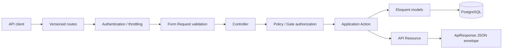
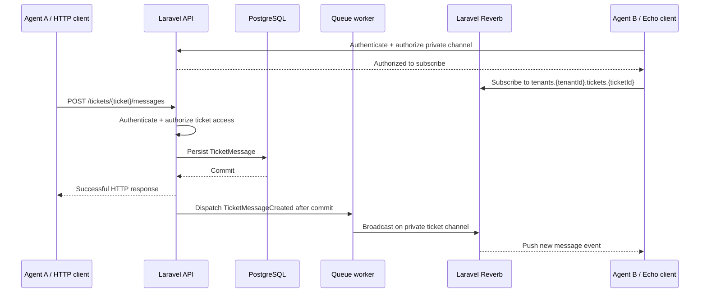
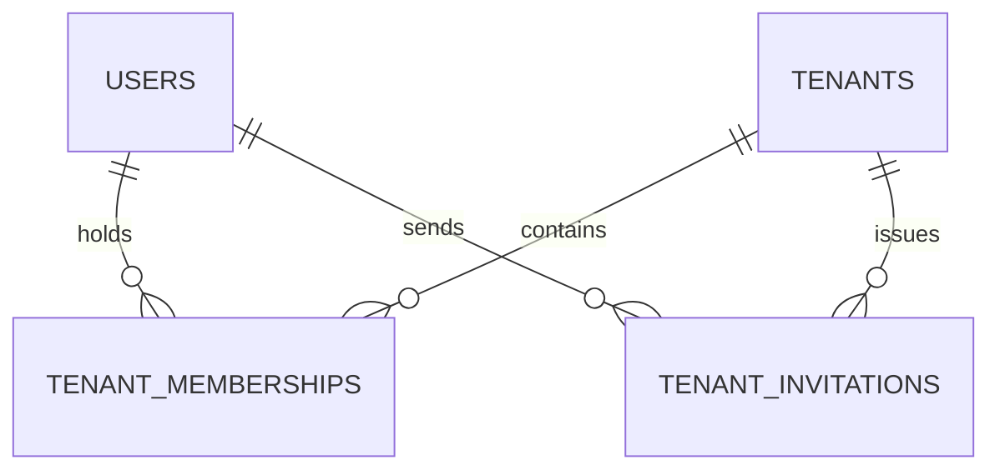
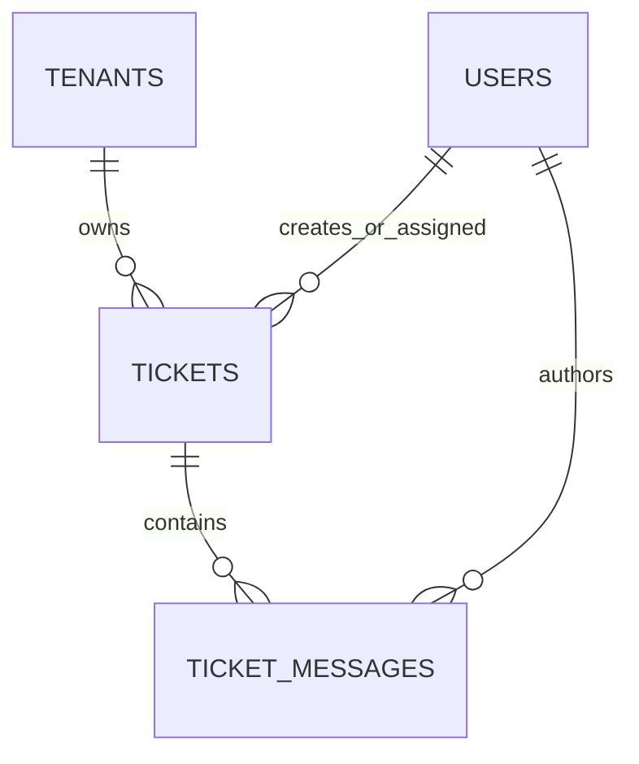

# SupportHub — System Architecture

> **Status:** Living architecture reference — API-only portfolio project, under development  
> **Last updated:** 30 October 2026  
> **Scope:** Identity + multi-tenancy and membership management + ticket management + internal real-time ticket chat

## Overview

SupportHub is an **API-first, multi-tenant helpdesk** where companies manage their own support staff, tickets, assignments, and internal ticket conversations. It is a **feature-based modular monolith with pragmatic layered responsibilities**, implemented as a single Laravel application backed by PostgreSQL.

Tenants share one database and schema. Each tenant-owned record is scoped to a company through `tenant_id`, and application authorization checks active membership and permissions before granting access. One global user may belong to several companies with different roles.

This is intentionally a **learning and portfolio API**, not a complete commercial helpdesk SaaS. The committed MVP excludes subscription billing, a dedicated contacts/customer module, customer accounts or a customer portal, customer-facing replies, attachments, SLAs, analytics, and a full product UI. Requester details live directly on tickets for now.

## Delivery status

| Capability | Status | Details |
| --- | --- | --- |
| API foundation | **Implemented** | `/api/v1`, health check, standardized JSON responses and API exception rendering |
| Identity | **Implemented** | Registration, login, `me`, logout, Sanctum bearer tokens, authentication rate limits |
| Tenant workspaces | **Implemented** | Create/list/view tenants; initial owner membership created transactionally |
| Tenant authorization | **Implemented for current endpoints** | Active-membership checks, tenant/member visibility, owner-only invitation creation |
| Member listing | **Implemented** | List tenant members with user information, roles, and statuses |
| Email invitations | **Implemented** | Owner creates an agent invitation; secure token hashing, expiry, duplicate protection, queued encrypted email |
| Invitation acceptance | **Implemented** | Authenticated email matching, one-time acceptance, transactional membership creation |
| Invitation tests | **Implemented** | Creation, notification dispatch, authorization, duplicates, expired/revoked/used tokens, wrong email |
| Membership administration | **Next** | Admin role, change roles, suspend/reactivate, remove member, protect last owner |
| Ticket management | **Planned** | Tenant-scoped CRUD, priorities, statuses, assignment and authorization |
| Ticket messages | **Planned** | Persistent staff-only conversation within each ticket, paginated message history |
| Real-time delivery | **Planned** | Laravel Reverb, Broadcasting, private channels, Echo, queued broadcasts |
| Portfolio completion | **Planned** | Focused security tests, API docs, GitHub Actions CI, README and optional deployment |

**Verification note:** The latest shared test output reported 47 passes and one duplicate-invitation failure. The duplicate-handling code was corrected afterward, but a full passing rerun has not yet been shared. Avoid treating this document as evidence of a green CI build.

## Technology and deployment shape

| Concern | Technology |
| --- | --- |
| Runtime | PHP 8.5 (development environment) |
| Web framework | Laravel 13 |
| Persistence | PostgreSQL; one shared database/schema |
| Authentication | Laravel Sanctum bearer tokens |
| Authorization | Laravel Policies/Gates + explicit tenant-scoped data access |
| Validation and serialization | Form Requests and API Resources |
| Background processing | Laravel database queues for invitation notifications |
| Email | Laravel Notifications; SMTP (Mailtrap for local testing) |
| Tests | Pest with Laravel feature testing and database isolation |
| Planned real-time stack | Laravel Reverb, Broadcasting, Echo, private WebSocket channels |
| Code style | Laravel Pint |

Exact dependencies and versions are defined in [`composer.json`](../../composer.json).

The application remains one deployable codebase. WebSocket and queue workers are **supporting processes**, not new business microservices.

## Module boundaries

**Implemented structure:**

```text
app/
├── Models/
│   └── User.php                  # Global user identity
├── Modules/
│   ├── Identity/                 # Auth endpoints and tokens
│   └── Tenancy/                  # Tenants, memberships and invitations
│       ├── Actions/
│       ├── Enums/
│       ├── Http/
│       ├── Models/
│       ├── Notifications/
│       ├── Policies/
│       └── Routes/
└── Shared/
    └── Http/                    # API response and exception helpers
```

**Planned addition:**

```text
app/Modules/Tickets/
├── Actions/                     # Create/update/assign ticket, post message
├── Enums/                       # Ticket status and priority
├── Events/                      # TicketMessageCreated broadcast event
├── Http/                        # Controllers, requests, resources
├── Models/                      # Ticket, TicketMessage
├── Policies/                    # Ticket-level permissions
└── Routes/
```

Ticket messages remain **inside the Tickets module**. A separate Conversations module is not necessary for the current scope. Neither Billing nor Customers is part of the committed MVP. `Shared` contains cross-cutting infrastructure, **not business use cases**.

### Responsibility rules

- **Routes/middleware:** Expose versioned endpoints and apply authentication/rate limits.
- **Form Requests:** Validate and normalize HTTP input.
- **Policies/Gates:** Determine who may perform actions within a tenant.
- **Controllers:** Coordinate HTTP input/output; avoid business workflows.
- **Actions:** Implement meaningful write use cases, invariants, transactions and side effects.
- **Eloquent models:** Represent persistence and relationships. Use direct Eloquent reads when clear; add Query classes only for genuinely complex queries.
- **API Resources + `ApiResponse`:** Serialize stable JSON contracts.
- **Events/queues:** Deliver asynchronous side effects without becoming the source of truth.

Do not introduce a repository layer, service interfaces, or additional architectural layers without a concrete need.

## HTTP request lifecycle



For a simple read, a controller can make a properly scoped Eloquent query instead of invoking an Action. `ApiExceptionRenderer` standardizes API failures while Laravel retains its normal behavior for non-API requests.

### Response contract

```json
{
  "success": true,
  "message": "SupportHub API is running.",
  "data": { "status": "healthy" },
  "errors": null
}
```

Failures use the same top-level keys, with `success: false`, `data: null`, an appropriate HTTP status, and error information in `errors`.

## Implemented API surface

| Method | Endpoint | Access |
| --- | --- | --- |
| `GET` | `/api/v1/health` | Public |
| `POST` | `/api/v1/auth/register` | Public; rate limited |
| `POST` | `/api/v1/auth/login` | Public; rate limited |
| `GET` | `/api/v1/auth/me` | Authenticated |
| `POST` | `/api/v1/auth/logout` | Authenticated |
| `GET` | `/api/v1/tenants` | Authenticated; returns active memberships only |
| `POST` | `/api/v1/tenants` | Authenticated |
| `GET` | `/api/v1/tenants/{tenant}` | Active tenant member |
| `GET` | `/api/v1/tenants/{tenant}/members` | Active tenant member |
| `POST` | `/api/v1/tenants/{tenant}/invitations` | Active owner; rate limited |
| `POST` | `/api/v1/invitations/accept` | Authenticated invited email |

Module route files are assembled under the root `/api/v1` routing configuration. Endpoints listed below are **design targets, not implemented routes**.

## Multi-tenancy and membership

### Current identity model

- `users`: Global staff identities; a user may work for multiple companies.
- `tenants`: Company workspaces.
- `tenant_memberships`: `(tenant_id, user_id)` membership, role, and `active`/`suspended` status.
- `tenant_invitations`: Email, invited role, token hash, inviter, expiration, and accepted/revoked timestamps.
- A tenant creator gets an active **Owner** membership inside the tenant-creation transaction.
- Current invitation creation adds users as **Agents** once they explicitly accept.

**Role-management target:** `Owner`, `Admin`, and `Agent`. The Owner/Agent workflow is already used; Admin permissions and member-management endpoints are part of the next implementation milestone. Role changes, suspension/reactivation and removal must not accidentally eliminate a tenant's last active Owner.

### Authorization boundaries

1. Authenticate with Sanctum. A requested `tenant_id` is never proof of membership.
2. Confirm the caller has an **active** membership in the target tenant and the action is allowed for their role.
3. Scope all tenant-owned Eloquent queries and nested route bindings to the authorized tenant.
4. Check related records: an assignee, message, and ticket must all belong to the same tenant.
5. Enforce uniqueness and foreign-key integrity at the database level, not only through preflight queries.
6. Test both cross-tenant access and suspended-member access for every sensitive endpoint.
7. Apply the same authorization rule to **private WebSocket channel subscriptions** and normal HTTP routes.

Existing policy checks protect tenant visibility and invitations. The future ticket workflow will have separate ticket permissions and tenant-scoped bindings. Prefer explicit authorization and scoping over relying only on a global model scope.

### Invitations: implemented workflow

```mermaid
sequenceDiagram
    participant Owner
    participant API as Laravel API
    participant DB as PostgreSQL
    participant Worker as Queue worker
    participant Recipient
    Owner->>API: POST /tenants/{tenant}/invitations
    API->>API: Authorize owner; normalize email
    API->>DB: Lock tenant row; validate uniqueness; save token hash
    DB-->>API: Commit invitation
    API-->>Owner: 201 metadata (never plaintext token)
    API->>Worker: Queued encrypted email after commit
    Worker-->>Recipient: Invitation link
    Recipient->>API: Authenticated POST /invitations/accept
    API->>DB: Lock invitation; validate email and expiry
    API->>DB: Create active membership + mark accepted atomically
    API-->>Recipient: 200 and tenant membership details
```

The token is generated with cryptographically secure randomness and stored as its SHA-256 hash. The one-time, seven-day invitation rejects expired, revoked, already-used, invalid and duplicate membership cases. The acceptance user must authenticate with the invited email. Email links use configurable `SUPPORTHUB_FRONTEND_URL`; there is **no implemented frontend** in this API-only MVP.

## Planned ticket domain

The MVP ticket is an internal support-team work item; staff create and manage tickets on behalf of customers. For speed and focus, requester details are fields on `tickets`, **not** a separate customer identity/contact system.

```text
Ticket
  tenant_id
  title
  description
  requester_name
  requester_email
  priority       low | medium | high
  status         open | in_progress | resolved | closed
  assigned_to    nullable user ID (active team member in same tenant)
  created_by     staff user ID
  timestamps

TicketMessage
  tenant_id
  ticket_id
  user_id        staff author
  body
  timestamps
```

These are **proposed logical fields**, not a claim about current migrations. Final migration and model names should follow the actual implementation. Messages are internal to support staff; the MVP has **no customer chat endpoint**.

### Planned REST endpoints

| Method | Endpoint | Purpose |
| --- | --- | --- |
| `POST` | `/api/v1/tenants/{tenant}/tickets` | Create ticket |
| `GET` | `/api/v1/tenants/{tenant}/tickets` | List tenant tickets, paginated |
| `GET` | `/api/v1/tenants/{tenant}/tickets/{ticket}` | Ticket detail |
| `PATCH` | `/api/v1/tenants/{tenant}/tickets/{ticket}` | Update fields, priority, or status |
| `PATCH` | `/api/v1/tenants/{tenant}/tickets/{ticket}/assign` | Assign active tenant agent |
| `GET` | `/api/v1/tenants/{tenant}/tickets/{ticket}/messages` | Retrieve message history |
| `POST` | `/api/v1/tenants/{tenant}/tickets/{ticket}/messages` | Persist and publish staff message |

For nested ticket endpoints, both the authorized tenant and ticket ownership must be checked. Pagination prevents unbounded lists and message-history responses.

## Planned real-time chat architecture

**Goal:** Learn genuine WebSocket-based server push with Laravel **Reverb**, **Broadcasting**, and **Echo**. This is a required project learning milestone, not an optional feature. There is no requirement for a complete frontend application: a minimal Echo client in two browser sessions is enough to validate delivery.



Implementation principles:

- **HTTP writes, WebSocket reads:** POST remains the authoritative way to send messages. WebSockets distribute events to already-connected authorized listeners.
- **Database is the source of truth:** Reconnect/reload clients fetch history via the REST endpoint; events are not the only copy of a message.
- **Private channels:** Subscription authorization must check Sanctum-authenticated user, active tenant membership, and ticket viewing permission. Never broadcast to a public cross-tenant channel.
- **Commit before broadcast:** Emit queued events only when the message has committed. Use Laravel's after-commit dispatch mechanisms as appropriate.
- **Minimal event payload:** Expose only data authorized members may see; never expose tokens or unrelated tenant details.
- **Testing:** Feature tests for message persistence and authorization; broadcast event tests; manual two-client Reverb/Echo verification for real-time delivery.
- **Operations:** The Laravel HTTP server, queue worker, and Reverb WebSocket server run as separate processes in development/deployment.

Typing indicators, online presence, read receipts, and client-side polish are **optional future enhancements**, not required for the MVP.

## Current and future data relationships

**Implemented:**



**Planned additions:**



The [database architecture document](../database/README.md) may still describe the **older, expanded** design (contacts, billing, conversations). It must be aligned with this reduced MVP before it is treated as authoritative for new migrations.

## Testing and engineering constraints

- Use **Pest feature tests** for validation, HTTP contracts, policy checks, transactions, and cross-tenant isolation.
- Confirm token secrecy, invitation replay protection, expired/revoked handling and correct recipient email.
- For membership management, test Owner/Admin/Agent permissions, suspension behavior and last-owner invariants.
- For tickets, test cross-tenant nested IDs, invalid assignees and authorized ticket transitions.
- For chat, test that unauthorized or suspended users cannot post, read history, or subscribe to private broadcast channels.
- Use `Notification::fake()` for invitation notification assertions. Fake notifications are not proof of worker delivery; local SMTP/queue integration is verified separately.
- Prefer transactions for multi-write operations; use row locks where concurrency could violate invariants.
- Keep `.env`, SMTP credentials, Sanctum tokens, and invitation links out of version control and logs.
- Avoid unnecessary repositories, generic service layers, premature microservices, and unrelated SaaS features.
- Finish with API documentation, a clear GitHub README, GitHub Actions CI and optional deployment if feasible.

## Delivery sequence

1. **Finish membership administration:** Admin role, role changes, suspend/reactivate, removal, last-owner protection, and focused Pest tests.
2. **Build ticket management:** Models and migrations, tenant-scoped CRUD, assignment, priorities/statuses, policies, and tests.
3. **Build internal ticket conversation:** Persistent messages and paginated history, with tenant isolation tests.
4. **Enable real-time messaging:** Reverb, Broadcasting, private channel authorization, Echo client, queue/commit handling, and two-client verification.
5. **Portfolio finish:** Full tests, security review, API documentation, CI, README, optional deployment. Freeze scope.

This architecture document is a **plan plus implementation record**, not a guarantee that planned endpoints, models, or infrastructure are already present.
