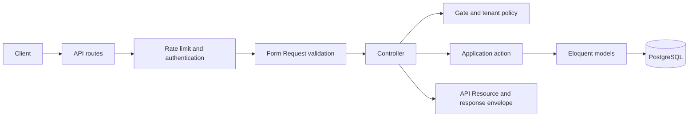
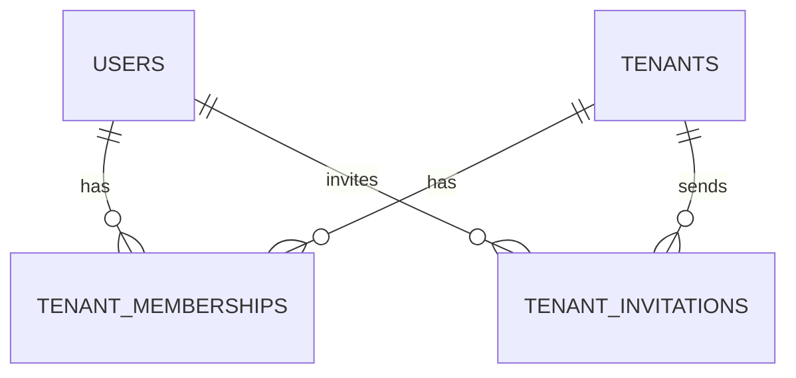

# SupportHub — System Architecture

> **Status:** Living architecture reference  
> **Last reviewed:** 30 October 2026

## Overview

SupportHub is an API-first, multi-tenant helpdesk SaaS. A company creates a
workspace, adds support staff, manages customer tickets, and pays for its own
subscription.

The application is a **modular Laravel monolith**: one deployable application
with code grouped by business capability. It uses a shared PostgreSQL database
and schema, with tenant-owned data separated by `tenant_id`.

## Current implementation

The following capabilities exist today:

- A versioned JSON API under `/api/v1`.
- Registration and login with 30-day Laravel Sanctum bearer tokens.
- Authenticated profile and logout endpoints.
- Rate limiting on registration and login.
- Tenant creation inside a database transaction.
- Automatic creation of an active `owner` membership for the tenant creator.
- Tenant listing, tenant detail, and member listing with membership-based access.
- Owner-only invitations with expiring, single-use tokens and queued email.
- Invitation acceptance by the authenticated user whose email was invited.
- Shared JSON success and error envelopes.
- Feature tests for the API foundation, identity flows, tenant access, and
  invitation workflows.

Tickets, customer contacts, conversations, billing, tenant selection, and
general ticket or billing notifications are not implemented yet. Tenant
authorization currently covers viewing workspaces and members and creating
invitations; broader tenant context and authorization remain future work.

## Technology

| Area | Current choice |
| --- | --- |
| Runtime | PHP 8.5 |
| Framework | Laravel 13 |
| Database | PostgreSQL |
| Authentication | Laravel Sanctum 4 |
| Testing | Pest 5 |
| API | Versioned JSON API |
| Architecture | Modular monolith |
| Tenancy | Shared database and schema |

Package constraints are defined in [`composer.json`](../../composer.json).

## Application boundaries

```text
app/
├── Models/
│   └── User.php
├── Modules/
│   ├── Identity/
│   └── Tenancy/
└── Shared/
    └── Http/
```

- `Identity` owns registration, authentication, tokens, and the authenticated
  user representation.
- `Tenancy` owns tenants, memberships, workspace roles, invitations, and the
  invitation email notification.
- `Shared` contains cross-cutting HTTP response and exception handling only; it
  must not become a home for business logic.
- `User` remains a global model because one user may belong to multiple tenants.

Within a module, HTTP concerns live under `Http`, use-case orchestration lives
in `Actions`, and module-owned models and enums remain inside that module.
Controllers validate input through Form Requests, delegate business work to an
action when needed, and return API Resources through the shared response
helper. New layers or abstractions should be introduced only when they solve a
concrete problem.

Planned capabilities will become modules when implementation begins:
`Customers`, `Tickets`, `Conversations`, `Billing`, and broader `Notifications`.

## Request lifecycle



API exceptions are rendered consistently by `ApiExceptionRenderer`. Non-API
requests keep Laravel's normal exception handling.

### Response contract

Every API response uses the same top-level shape:

```json
{
    "success": true,
    "message": "SupportHub API is running.",
    "data": {
        "status": "healthy"
    },
    "errors": null
}
```

Failed responses set `success` to `false`, set `data` to `null`, and use the
appropriate HTTP status. Validation errors are returned in `errors`.

### Implemented endpoints

| Method | Endpoint | Access |
| --- | --- | --- |
| `GET` | `/api/v1/health` | Public |
| `POST` | `/api/v1/auth/register` | Public; rate limited |
| `POST` | `/api/v1/auth/login` | Public; rate limited |
| `GET` | `/api/v1/auth/me` | Sanctum token |
| `POST` | `/api/v1/auth/logout` | Sanctum token |
| `GET` | `/api/v1/tenants` | Sanctum token; active memberships only |
| `POST` | `/api/v1/tenants` | Sanctum token |
| `GET` | `/api/v1/tenants/{tenant}` | Sanctum token; active member |
| `GET` | `/api/v1/tenants/{tenant}/members` | Sanctum token; active member |
| `POST` | `/api/v1/tenants/{tenant}/invitations` | Sanctum token; active owner; rate limited |
| `POST` | `/api/v1/invitations/accept` | Sanctum token; invited email |

Routes are assembled from the root API route file and each module's `Routes`
directory.

### Tenant and invitation behavior

- Tenant listing returns the workspaces for the caller's active memberships,
  with the caller's role added to each tenant. Tenant detail requires an active
  membership. A guest receives `401`; an outsider or suspended member receives
  `403` for an existing tenant.
- Any active member can list a tenant's memberships, including suspended
  members. Each entry contains the membership ID, the user's ID, name and
  email, role, and status.
- Only an active owner can invite a member. The request requires an `email`;
  the server trims and lowercases it, rejects existing members and duplicate
  unexpired pending invitations, and creates an `agent` invitation valid for
  seven days. The `201` response includes the invitation ID, email, role, and
  expiry, but never the token. Invitation creation is limited to ten requests
  per minute.
- An encrypted, queued notification sends the acceptance link after the
  transaction commits. `SUPPORTHUB_FRONTEND_URL` controls the link's frontend
  base URL and defaults to `http://localhost:3000`.
- Acceptance requires a signed-in user to submit the 64-character token. The
  user's email must match the invitation. Acceptance creates an active
  membership and records `accepted_at` in one transaction. Expired, revoked,
  used, or invalid invitations return `422`; a different account receives
  `403`.

## Multi-tenancy

### Identity and membership

- A user is a global login identity.
- A tenant is a company workspace.
- A tenant membership connects a user to a tenant.
- Membership roles are `owner`, `admin`, and `agent`.
- Membership statuses are `active` and `suspended`.
- A user may hold different roles in different tenants.
- An invitation is addressed to an email, not to an existing user ID; the
  invitee must sign in or register before accepting it.

Customers are not staff memberships. The planned database design models them
as tenant-scoped contacts; see the
[`database architecture`](../database/README.md).

### Isolation rules

All future tenant-owned resources must follow these rules:

1. Derive tenant context from an authenticated, authorized membership; a
   request-supplied `tenant_id` is never proof of access.
2. Scope reads and writes to the current tenant, including route binding,
   search, exports, attachments, and background jobs.
3. Ensure related records belong to the same tenant before associating them.
4. Use database constraints and indexes to preserve tenant integrity.
5. Enforce access with policies or equivalent authorization in addition to
   query scoping.
6. Test cross-tenant read, create, update, and delete attempts.

A global Eloquent scope may reduce repetition, but it must not be the only
security control.

## Current data model



| Entity | Purpose | Important constraints |
| --- | --- | --- |
| `users` | Global staff identity | Unique email |
| `tenants` | Company workspace | Unique slug; constrained status |
| `tenant_memberships` | User access within a tenant | Unique tenant/user pair; constrained role and status |
| `tenant_invitations` | Pending and completed invitations | Unique token hash; tenant and inviter foreign keys; expiry and lifecycle timestamps |

The target schema for tickets, contacts, conversations, and billing belongs in
the [`database architecture`](../database/README.md). That document is the
source of truth for planned tables; this page describes application-level
boundaries and data flow.

## Testing expectations

- Feature tests cover HTTP contracts, validation, authentication,
  authorization, database behavior, and complete workflows.
- Unit tests are reserved for isolated domain rules that do not need Laravel or
  the database.
- Tenant-owned features require explicit cross-tenant isolation tests.
- Billing webhooks must be signature-verified and idempotency-tested when that
  module is implemented.
- The narrowest relevant Pest tests should pass before running the full suite.

## Architectural constraints

- Prefer Laravel conventions and Eloquent over custom infrastructure.
- Keep controllers thin and business operations explicit.
- Use Form Requests for validation and API Resources for public
  representations.
- Use named routes when generating internal links.
- Run side effects after successful database transactions when consistency
  depends on committed data.
- Do not introduce repositories, service interfaces, or empty architectural
  layers without a demonstrated need.
- Keep payment-provider details out of the architecture until a provider and
  integration approach are selected.
