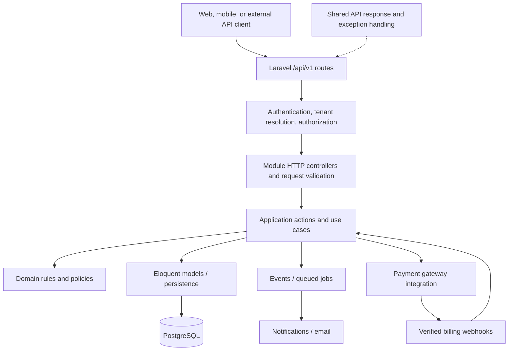
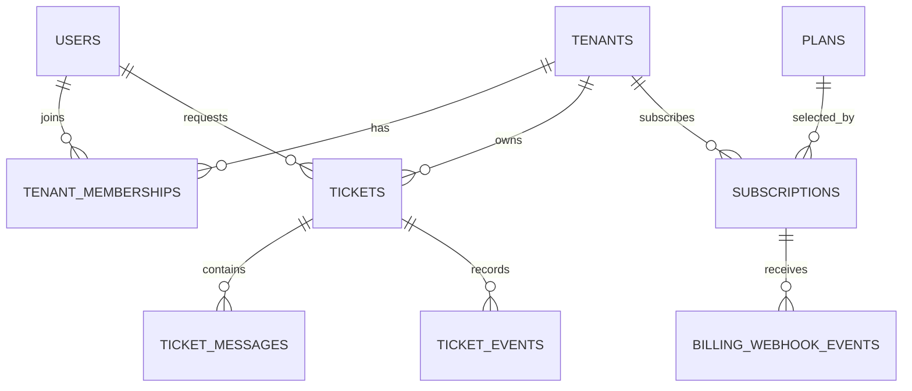
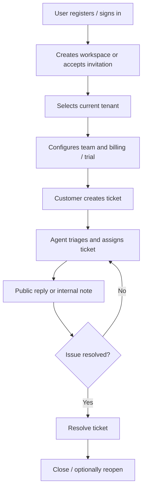

# SupportHub — System Architecture

> **Project:** Multi-Tenant Helpdesk SaaS  
> **Document:** Architecture, repository structure, and implementation roadmap  
> **Status:** Living design document — project in development  
> **Last reviewed:** 22 October 2026

## 1. Project overview

**SupportHub** is an API-first, multi-tenant helpdesk SaaS platform. A business creates a workspace (a **tenant**), invites its support team, receives customer support tickets, collaborates on responses, and pays SupportHub for a workspace subscription.

The project is designed both as a realistic backend engineering portfolio project and as an application another developer can understand, extend, test, and deploy.

### Goals

- Isolate every company's data securely inside one application.
- Support a complete ticket workflow: creation, triage, assignment, conversation, resolution, and closure.
- Support team membership, roles, and authorization within each tenant.
- Charge **companies for SupportHub subscriptions**; customers do not pay SupportHub to create tickets.
- Keep the codebase maintainable through clear module boundaries, consistent APIs, automated tests, and documentation.

### Intended users

| Actor                | Responsibility                                                  |
| -------------------- | --------------------------------------------------------------- |
| Platform operator    | Operates SupportHub and oversees platform-level administration. |
| Tenant owner / admin | Manages a company's workspace, members, and subscription.       |
| Support agent        | Manages assigned tickets, replies, and internal notes.          |
| Customer / requester | Creates support requests and views their own conversations.     |

## 2. Technology and architectural choices

| Area            | Choice                             | Notes                                                                   |
| --------------- | ---------------------------------- | ----------------------------------------------------------------------- |
| Language        | PHP 8.5.4                          | Current development environment.                                        |
| Framework       | Laravel 13                         | HTTP, routing, validation, auth, queues, events, and Eloquent.          |
| Database        | PostgreSQL                         | Relational storage and constraints.                                     |
| API             | Versioned JSON API (`/api/v1`)     | Shared success/error response conventions.                              |
| Authentication  | Laravel Sanctum                    | Token table migrated; full login and authorization flows are planned.   |
| Testing         | Pest                               | Unit and Laravel Feature Tests.                                         |
| Architecture    | **Modular Monolith**               | One deployed application, separated by business capability.             |
| Module design   | **Pragmatic layered architecture** | HTTP → application use cases → domain rules → persistence/integrations. |
| Tenancy         | **Shared database, shared schema** | Tenant-owned records are scoped with `tenant_id`.                       |
| Billing         | Tenant subscription billing        | Payment provider to be chosen when the Billing module begins.           |
| Background work | Laravel queues / scheduler         | Planned for emails, notifications, and webhook processing.              |

**Architectural intent:** Use native Laravel capabilities where they fit. Add abstractions—such as repositories, interfaces, event buses, or service classes—only when they solve a real problem. This is **not** a microservices architecture, and it is not a strict implementation of Clean Architecture.

## 3. High-level system architecture



### Request lifecycle

1. The client makes a request to a versioned API endpoint.
2. Laravel resolves the route and runs applicable middleware.
3. Authentication establishes the user's identity; tenant context is established from a trusted, validated request context.
4. Validation and policies reject invalid or unauthorized operations.
5. An application action executes the business use case and persists changes.
6. A standardized JSON response is returned. Exceptions are converted into consistent error responses.
7. Side effects such as notifications may run asynchronously after a successful transaction.

### API response convention

The shared response helper and exception renderer establish an envelope such as:

```json
{
    "success": true,
    "message": "SupportHub API is running.",
    "data": { "status": "healthy" },
    "errors": null
}
```

Error responses preserve the same top-level keys with an appropriate **HTTP error status** (for example, `404` for an unknown route). The exact validation-error contract will be finalized when request validation is implemented.

## 4. Business modules and ownership

| Module            | Owns                              | Key responsibilities                                                                    |
| ----------------- | --------------------------------- | --------------------------------------------------------------------------------------- |
| **Identity**      | Global users and authentication   | Login, registration, tokens, account identity.                                          |
| **Tenancy**       | Tenants and memberships           | Workspace lifecycle, joining/inviting members, selecting and validating tenant context. |
| **Tickets**       | Tickets and workflow              | Create, list, assign, prioritize, change status, resolve, close, audit status changes.  |
| **Conversations** | Ticket discussion                 | Public customer replies, agent replies, internal notes; attachments later.              |
| **Billing**       | Plans and subscriptions           | Tenant subscriptions, provider checkout, webhooks, entitlement checks.                  |
| **Notifications** | Delivery of alerts                | Ticket and billing notifications, email/queue orchestration.                            |
| **Shared**        | Cross-cutting technical utilities | Consistent HTTP responses, exception rendering, and genuinely reusable infrastructure.  |

**Boundary rules**

- Each business module owns its use cases and rules; controllers should stay thin.
- Cross-module work should occur through intentional actions, services, or events; do not scatter business writes across unrelated modules.
- Eloquent is the default persistence approach. A repository abstraction is optional, **not mandatory**.
- The `Shared` directory must not become a catch-all for business logic.
- A dedicated `Domain/` or `Infrastructure/` directory is introduced when useful, rather than creating empty layers in every module.

## 5. Target repository structure

The tree below is a **target layout**, not a claim that every file or module exists today. Paths are illustrative; files will be added only when their features are implemented.

```text
multi-tenant-helpdesk-saas/
├── app/
│   ├── Http/
│   │   └── Controllers/                 # Laravel default; can remain
│   ├── Models/
│   │   └── User.php                     # Existing Laravel global User model (for now)
│   ├── Providers/                       # Laravel service providers
│   ├── Shared/
│   │   └── Http/
│   │       ├── Responses/
│   │       │   └── ApiResponse.php
│   │       └── Exceptions/
│   │           └── ApiExceptionRenderer.php
│   └── Modules/
│       ├── Identity/
│       │   ├── Http/{Controllers,Requests,Resources}/
│       │   ├── Application/Actions/
│       │   └── Policies/
│       ├── Tenancy/
│       │   ├── Http/{Controllers,Requests,Resources}/
│       │   ├── Application/Actions/
│       │   ├── Models/                  # Tenant, TenantMembership
│       │   ├── Policies/
│       │   └── Domain/                  # Rules/enums when needed
│       ├── Tickets/
│       │   ├── Http/{Controllers,Requests,Resources}/
│       │   ├── Application/Actions/
│       │   ├── Models/
│       │   ├── Policies/
│       │   └── Domain/
│       ├── Conversations/
│       │   ├── Http/{Controllers,Requests,Resources}/
│       │   ├── Application/Actions/
│       │   └── Models/
│       ├── Billing/
│       │   ├── Http/{Controllers,Requests}/
│       │   ├── Application/Actions/
│       │   ├── Models/
│       │   └── Infrastructure/          # Gateway integration, webhook adapters
│       └── Notifications/
│           ├── Listeners/
│           └── Jobs/
├── bootstrap/
│   └── app.php                          # Routing and exception registration
├── config/
├── database/
│   ├── migrations/
│   ├── factories/
│   └── seeders/
├── routes/
│   └── api.php                          # Versioned API entry point
├── tests/
│   ├── Pest.php
│   ├── TestCase.php
│   ├── Feature/
│   │   ├── Shared/Http/
│   │   │   ├── HealthCheckTest.php
│   │   │   └── ApiErrorTest.php
│   │   ├── Identity/
│   │   ├── Tenancy/
│   │   ├── Tickets/
│   │   ├── Conversations/
│   │   └── Billing/
│   └── Unit/
│       ├── Tenancy/
│       ├── Tickets/
│       └── Billing/
├── docs/
│   └── architecture/
│       └── README.md                    # This document
├── .env.example
├── composer.json
├── phpunit.xml
└── README.md                             # Public project overview and setup
```

**Laravel defaults:** Keep `app/Http/Controllers` and `app/Models` rather than removing them prematurely. When authentication is ready to be refactored, the global `User` model may move into the Identity module after updating configuration, factories, references, and tests.

**Testing convention:** `tests/Feature` covers HTTP workflows, database integration, roles, and tenant isolation; `tests/Unit` covers isolated PHP domain behavior. Feature tests are grouped by module and are written with Pest.

## 6. Multi-tenancy design

**Strategy:** One PostgreSQL database and one schema shared by all companies. Each tenant-owned row has a `tenant_id`, and access is always limited to the authorized current tenant.

### Identity and membership

- A **user** is a global login identity and may belong to more than one tenant.
- A **tenant** represents a customer company/workspace.
- A **tenant membership** connects a user to a tenant and records their role or status.
- Initial workspace roles: `owner`, `admin`, `agent`, and `customer` (exact role capabilities finalized during authorization implementation).
- A user must have authorized membership or a deliberately defined platform-level permission to access a tenant's resources.

### Non-negotiable isolation rules

1. Never trust an arbitrary `tenant_id` supplied in a request body as proof of access.
2. Authenticate the user and verify membership/authorization for the requested tenant.
3. Scope ticket and message reads and writes to that tenant, including route model binding and exports.
4. Validate that related records (assignee, ticket, requester, messages) belong to the same authorized tenant where required.
5. Use database constraints and indexes to support integrity; application authorization remains essential.
6. Test **cross-tenant read, write, update, and delete attempts** explicitly.

Tenant scoping through a global model scope can be a convenience but must not be the only security control. Policies and trusted tenant-aware queries provide defense in depth.

## 7. Planned data model

The following is **conceptual**, not yet the final PostgreSQL schema.



| Table / entity           | Essential fields (illustrative)                                                   |
| ------------------------ | --------------------------------------------------------------------------------- |
| `users`                  | `id`, `name`, `email`, `password`                                                 |
| `tenants`                | `id`, `name`, `slug`, `status`                                                    |
| `tenant_memberships`     | `id`, `tenant_id`, `user_id`, `role`, `status`                                    |
| `tickets`                | `id`, `tenant_id`, `requester_id`, `assignee_id`, `subject`, `status`, `priority` |
| `ticket_messages`        | `id`, `tenant_id`, `ticket_id`, `author_id`, `body`, `visibility`                 |
| `ticket_events`          | `id`, `tenant_id`, `ticket_id`, `actor_id`, `event_type`, `metadata`              |
| `plans`                  | `id`, `code`, `name`, `provider_price_id`, `limits`                               |
| `subscriptions`          | `id`, `tenant_id`, `plan_id`, `provider_subscription_id`, `status`, billing dates |
| `billing_webhook_events` | `id`, provider event ID (unique), type, processing status                         |

**Migration design checklist:** Foreign keys, appropriate deletion behavior, unique tenant-member pairs, unique workspace slugs, indexes for tenant-scoped ticket lists, and safe treatment of cross-tenant references. Columns and naming are subject to review before migration creation.

## 8. Core business workflows

### Workspace-to-ticket lifecycle



### Ticket lifecycle (initial proposal)

`open` → `in_progress` → `waiting_on_customer` → `resolved` → `closed`

Transitions and who can perform them will become explicit domain rules. Internal notes must never be exposed to customers.

### Subscription lifecycle (initial proposal)

1. Tenant owner chooses a plan.
2. SupportHub creates a checkout or subscription through a payment provider.
3. The provider sends a signed webhook, which SupportHub verifies and processes idempotently.
4. The tenant's subscription status and plan limits are updated.
5. Access to paid functionality follows a documented policy for active, trialing, past-due, canceled, and expired states.

The precise payment provider and trial/grace-period behavior have **not yet been selected**.

## 9. API design principles

- Version routes under `/api/v1`.
- Use clear resource-oriented endpoints and correct HTTP status codes.
- Use Laravel Form Requests for validation and Policies for authorization.
- Return consistent JSON success and error envelopes.
- Use API Resources for stable public representations instead of returning unrestricted Eloquent models.
- Paginate lists and explicitly filter/sort tenant-scoped queries.
- Keep secrets and sensitive billing data out of responses and logs.

**Illustrative endpoints (not all implemented):**

```text
GET    /api/v1/health
POST   /api/v1/auth/login
POST   /api/v1/tenants
GET    /api/v1/tenants/{tenant}/tickets
POST   /api/v1/tenants/{tenant}/tickets
PATCH  /api/v1/tenants/{tenant}/tickets/{ticket}
POST   /api/v1/tenants/{tenant}/tickets/{ticket}/messages
POST   /api/v1/billing/webhooks/{provider}
```

## 10. Testing and quality strategy

**Framework:** Pest, with Laravel Feature Tests using the application test case.

| Level           | Example coverage                                                                      |
| --------------- | ------------------------------------------------------------------------------------- |
| Unit            | Ticket state transitions, plan limits, isolated PHP rules.                            |
| Feature/API     | Request validation, JSON contracts, authentication, role permissions, CRUD workflows. |
| Database        | Relationships, constraints, transaction behavior, migrations, factories.              |
| Tenant security | User from Tenant A cannot read or change Tenant B data.                               |
| Integration     | Verified, replay-safe webhook handling; queued notifications.                         |

Use a **separate testing database** (or isolated testing environment) before adding tests that refresh or migrate the database. CI, static analysis, and code formatting will be added as the project matures.

## 11. Delivery roadmap

The plan below is **sequenced by dependency**, not by calendar dates. Each milestone should conclude with working behavior, relevant tests, and updated documentation.

| Phase                             | Scope                                                                          | Definition of done                                                | Status                   |
| --------------------------------- | ------------------------------------------------------------------------------ | ----------------------------------------------------------------- | ------------------------ |
| **0. Foundation**                 | Laravel, PostgreSQL setup, versioned API, shared response/error handling, Pest | Health and unknown-route endpoints tested; initial migrations run | **Completed (baseline)** |
| **1. Architecture & DB design**   | Confirm boundaries, document model, database design conventions                | Reviewed tenancy schema before migrations                         | **Current**              |
| **2. Tenancy**                    | Tenants, memberships, active tenant context, isolation                         | Workspace creation and tenant isolation tests pass                | Planned                  |
| **3. Identity & access**          | Registration, login, Sanctum, invitations, roles, policies                     | Auth flows and unauthorized-access tests pass                     | Planned                  |
| **4. Tickets**                    | Ticket creation/listing, assignment, priority, status rules                    | Tenant-scoped ticket workflow with tests                          | Planned                  |
| **5. Conversations**              | Public replies, internal notes, audit history                                  | Visibility rules and conversation tests pass                      | Planned                  |
| **6. Billing**                    | Plans, checkout, subscriptions, verified webhooks, entitlements                | Subscription lifecycle covered with sandbox/integration tests     | Planned                  |
| **7. Notifications & operations** | Queues, emails, retries, scheduler, observability                              | Reliable background processing and useful logs                    | Planned                  |
| **8. Production readiness**       | Security review, CI, Docker, deployment, API docs, performance                 | Deployment and contributor setup are reproducible                 | Planned                  |
