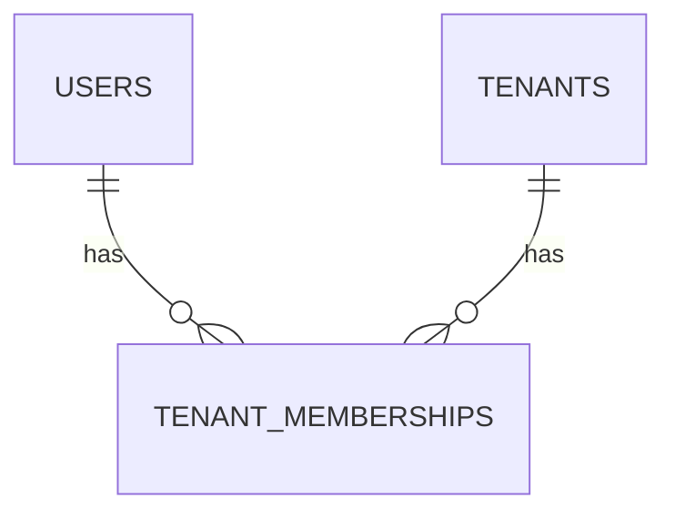
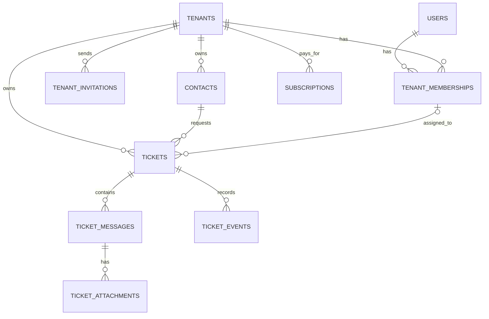

# SupportHub — Database Architecture

> **Database:** PostgreSQL  
> **Status:** Current schema and durable design rules  
> **Last reviewed:** 23 October 2026  
> **Related:** [`System architecture`](../architecture/README.md)

## Purpose

This document records the schema that exists today and the database rules that
future SupportHub modules must follow. Migration files are the source of truth
for the physical schema; this document explains their intent and the planned
relationships between modules.

## Current schema

All repository migrations are applied in the current development database:

| Migration | Tables created |
| --- | --- |
| `0001_01_01_000000_create_users_table` | `users`, `password_reset_tokens`, `sessions` |
| `0001_01_01_000001_create_cache_table` | `cache`, `cache_locks` |
| `0001_01_01_000002_create_jobs_table` | `jobs`, `job_batches`, `failed_jobs` |
| `2026_10_21_150708_create_personal_access_tokens_table` | `personal_access_tokens` |
| `2026_10_22_142059_create_tenants_table` | `tenants` |
| `2026_10_22_142100_create_tenant_memberships_table` | `tenant_memberships` |

PostgreSQL also maintains Laravel's `migrations` table. Cache, queue, session,
password reset, and Sanctum tables are framework infrastructure rather than
tenant-owned business data.

### Current relationships

A user is a global identity and may belong to multiple tenants. Roles and
membership status belong to the membership, never to the global user.

### `users`

| Column | Purpose |
| --- | --- |
| `id` | Global user key |
| `name` | Display name |
| `email` | Unique login email |
| `email_verified_at` | Optional verification time |
| `password` | Password hash |
| `remember_token` | Laravel authentication support |
| `created_at`, `updated_at` | Audit timestamps |

### `tenants`

| Column | Rule |
| --- | --- |
| `id` | Primary key |
| `name` | Maximum 160 characters |
| `slug` | Maximum 120 characters; globally unique |
| `status` | `active`, `suspended`, or `archived`; defaults to `active` |
| `timezone` | Maximum 64 characters; defaults to `UTC` |
| `created_at`, `updated_at` | Timezone-aware timestamps |

The database check constraint `tenants_status_check` rejects unsupported status
values.

### `tenant_memberships`

| Column | Rule |
| --- | --- |
| `id` | Primary key |
| `tenant_id` | Required foreign key to `tenants`; restricted on delete |
| `user_id` | Required foreign key to `users`; restricted on delete |
| `role` | `owner`, `admin`, or `agent` |
| `status` | `active` or `suspended` |
| `created_at`, `updated_at` | Timezone-aware timestamps |

The table enforces:

- One membership per `(tenant_id, user_id)`.
- A unique `(tenant_id, id)` pair for future tenant-safe composite foreign
  keys.
- Check constraints for the supported roles and statuses.
- An index on `user_id` for membership lookup by user.

Tenant creation and its initial active owner membership are written in one
application transaction.

## Tenancy rules

Every future tenant-owned table must follow these rules:

1. Store a non-null `tenant_id` unless the record is deliberately global or
   belongs to framework infrastructure.
2. Resolve tenant context from an authenticated, active membership. A posted
   `tenant_id` does not establish access.
3. Include tenant scope in every business query, route binding, background job,
   export, and file lookup.
4. Prevent cross-tenant relationships with composite foreign keys where they
   materially strengthen integrity. For example,
   `(tenant_id, requester_contact_id)` can reference
   `contacts(tenant_id, id)`.
5. Add `UNIQUE (tenant_id, id)` to a parent only when a composite foreign key
   requires it.
6. Use application authorization as well as database constraints. Foreign keys
   preserve relationships; they do not authorize requests.
7. Cover cross-tenant read and write attempts with tests.

## Planned business model

The following model is directional. Each module must finalize its fields,
constraints, and indexes immediately before its migrations are created.

| Module | Planned entities | Essential decision |
| --- | --- | --- |
| Tenancy | `tenant_invitations` | Tokens are expiring, single-use, and stored as hashes |
| Customers | `contacts` | Customers are tenant-scoped and are not staff memberships |
| Tickets | `tickets`, `ticket_events` | Requester and assignee must belong to the ticket's tenant |
| Conversations | `ticket_messages`, `ticket_attachments` | Public replies and internal notes have enforced visibility |
| Billing | `subscriptions` and provider-required records | The tenant is the payer; physical schema waits for provider selection |

Tags, read receipts, in-app notifications, invoices, plan catalogs, and other
supporting tables should be added only when a delivered feature requires them.

## Physical design rules

- Use numeric primary keys for internal relationships. Choose any public ticket
  identifier when the Tickets module is designed.
- Represent evolving statuses with PHP backed enums and string columns. Add
  database check constraints for small, stable value sets.
- Store business timestamps with timezone awareness and treat UTC as the
  storage baseline.
- Store money in integer minor units with an ISO currency code; never use
  floating point.
- Store secrets and access tokens as hashes. Never persist raw invitation,
  customer-access, or webhook secrets.
- Use `JSONB` for bounded metadata, not as a replacement for relational fields
  or foreign keys.
- Prefer restricted deletion for durable business history. Use cascades only
  for disposable child records after reviewing the impact.
- Add indexes from real query patterns. PostgreSQL does not automatically index
  every referencing foreign-key column.
- Process external webhook events idempotently with a unique provider event
  identifier after verifying the signature.

## Migration workflow

- Implement one business module at a time in dependency order.
- Inspect the current schema before creating a migration.
- Create new migrations for changes after an existing migration has been shared
  or applied.
- Add foreign keys, uniqueness, check constraints, and supporting indexes with
  the table that needs them.
- Keep provider-specific billing tables out of the schema until the provider
  and Laravel integration approach are selected.
- Update this document when a planned entity becomes an implemented table.

## Testing expectations

Database-facing tests use Pest with an isolated PostgreSQL database so
PostgreSQL constraints and types are exercised accurately.

Every new business table should test its important invariants, including:

- Required relationships and deletion behavior.
- Unique and check constraints.
- Same-tenant references and rejected cross-tenant references.
- Transactional creation of records that must exist together.
- Query behavior for the indexes that support important list screens.
- Idempotency and replay behavior for external billing events.

## Decisions deferred to their modules

- Customer authentication: expiring email access or registered accounts.
- Public ticket identifiers and any human-readable ticket numbering.
- Single or multiple ticket assignees.
- Payment provider and whether to use a Laravel billing package.
- Retention, anonymization, and tenant offboarding policies.

These decisions must be made before the affected migrations are written, not
before unrelated modules are developed.
