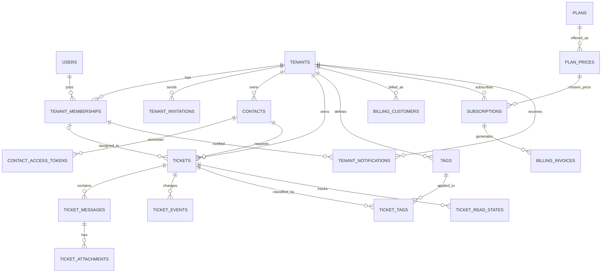

# SupportHub — PostgreSQL Database Architecture

> **Project:** SupportHub — Multi-Tenant Helpdesk SaaS  
> **Document type:** Engineering database design and implementation blueprint  
> **Last reviewed:** 22 October 2026  
> **Related document:** [`../architecture/README.md`](../architecture/README.md)

## 1. Purpose and scope

This document describes the **target relational database** for the complete SupportHub product—not merely the next migration. It is intended for developers, reviewers, contributors, and future maintainers. It explains the business model, entity relationships, fields, constraints, index strategy, security boundaries, implementation order, and testing criteria.

**Business summary:** Companies subscribe to SupportHub, invite support agents, accept tickets from their own customers, discuss those tickets through customer-visible replies and staff-only notes, and receive notifications. SupportHub charges **companies**, not end customers.

**Important:** Tables and columns below are **design proposals**. They are not claims that these features are implemented. Reconcile payment-provider-specific schema with the selected provider / Laravel billing package before coding that module.

### Current database baseline (verified from developer output)

The following Laravel migrations have already run:

- `0001_01_01_000000_create_users_table`
- `0001_01_01_000001_create_cache_table`
- `0001_01_01_000002_create_jobs_table`
- `2026_10_21_150708_create_personal_access_tokens_table`

Those migrations may create more than one table each (for example, password reset tokens, sessions, or queue-related tables). Inspect the migration files to determine the exact current schema. **Do not recreate or delete these tables.**

## 2. Foundational design decisions

| Area                | Decision                                                                                                   | Why                                                                              |
| ------------------- | ---------------------------------------------------------------------------------------------------------- | -------------------------------------------------------------------------------- |
| Architecture        | Modular monolith                                                                                           | One Laravel deployment with clear module boundaries.                             |
| Tenancy             | Single PostgreSQL database; shared schema                                                                  | Straightforward operations and migrations for an early-stage SaaS.               |
| Isolation           | `tenant_id` on every tenant-owned business record                                                          | Queries, constraints, authorization and tests can enforce ownership.             |
| Staff identity      | Global `users` account                                                                                     | One staff member may work for multiple companies.                                |
| Staff membership    | `tenant_memberships` joins `users` and `tenants`                                                           | Stores tenant-specific role/status, not a global user role.                      |
| Customer identity   | Tenant-scoped `contacts`, **not** tenant staff memberships                                                 | Customers can request help without joining a company's support team.             |
| Customer access     | Expiring, hashed contact-access links initially; accounts can come later                                   | Enables secure replies without creating staff identities for customers.          |
| Ticket conversation | Messages belong to tickets                                                                                 | Supports reply threads, attachments, internal notes and later realtime delivery. |
| Billing payer       | Tenant/company                                                                                             | The company purchases SupportHub subscription plans.                             |
| Keys                | `BIGINT` surrogate IDs for relational entities; public ticket ULID                                         | Eloquent-friendly joins plus opaque IDs for customer-facing URLs.                |
| Statuses            | String columns with application-level PHP backed enums and selected DB constraints                         | Easy to evolve without committing to PostgreSQL enum types.                      |
| Time                | `timestamptz` / timezone-aware UTC storage                                                                 | Reliable ordering across companies and payment providers.                        |
| Money               | Integer minor units plus ISO currency code                                                                 | Avoid floating-point rounding errors.                                            |
| Delete strategy     | Preserve ticket, billing and conversation history; suspend/archive instead of routinely cascading deletion | Support evidence, operational safety, and auditability.                          |

**Key clarification:** In the main architecture overview, the proposed `customer` membership role and `tickets.requester_id -> users` diagram were conceptual. This design refines them: **staff roles are `owner`, `admin`, `agent`; customers live in `contacts`, and tickets use `requester_contact_id`.** Update the main architecture README after this schema is approved.

## 3. How tenant data is separated

### Example

- **Tenant A:** Acme Company, support agents Alice and Karim, customers C1 and C2, tickets A-1 and A-2.
- **Tenant B:** Orbit Company, agent Karim, customer C3, ticket B-1.
- **Karim** has one global `users` row and two distinct `tenant_memberships` rows.
- A contact whose email happens to match in two companies has two different `contacts` rows.
- A ticket, message, assignment or attachment belonging to Acme must never be returned to Orbit's members.

### Rules

1. Tenant-owned tables carry `tenant_id NOT NULL`, except explicitly global framework, plan, or operational data.
2. Tenant context comes from an **authenticated and authorized membership**, not a posted `tenant_id` field alone.
3. Ticket reads, writes, message history, attachment downloads, search, exports and notifications are tenant-scoped.
4. Critical cross-tenant references use **composite foreign keys** where practical: e.g. `(tenant_id, requester_contact_id)` references `contacts(tenant_id, id)`.
5. Referenced parents require a corresponding unique key such as `UNIQUE(tenant_id, id)` for composite foreign keys. This creates an additional index on top of the global primary key; apply it to entities that need cross-tenant FK enforcement.
6. Application policies, route binding and tests remain required; foreign keys enforce data integrity but do not authorize HTTP requests.
7. Never expose internal billing credentials, raw invitation tokens, raw contact-access tokens or payment-card details through the database/API.

## 4. Entity relationship diagram

This diagram shows the logical foreign-key relationships. A `||--o{` line means one parent can have many children. Global Laravel infrastructure tables are omitted for readability.



`billing_webhook_events` is intentionally not dependent on a known tenant or subscription when first received; its relation to those records may only become known **after** signature verification and event parsing.

## 5. Schema catalog

**Notation:** `PK` = primary key; `FK` = foreign key; `UQ` = unique constraint; `NULL` = nullable; `JSONB` = PostgreSQL binary JSON. All normal writable records have `created_at` and `updated_at` unless noted. Numeric foreign keys are `BIGINT` to match Laravel's `$table->id()`. Fields shown are the intended schema, not pseudocode for migrations.

### 5.1 Identity — existing foundation

#### `users` — existing Laravel table

| Column              | Type / rule      | Description                                 |
| ------------------- | ---------------- | ------------------------------------------- |
| `id`                | BIGINT PK        | Global login identity.                      |
| `name`              | VARCHAR          | Staff display name.                         |
| `email`             | VARCHAR UQ       | Global login email; normalize to lowercase. |
| `email_verified_at` | TIMESTAMPTZ NULL | Email verification.                         |
| `password`          | VARCHAR          | Password hash, never plaintext.             |
| `remember_token`    | VARCHAR NULL     | Laravel auth support.                       |
| timestamps          | TIMESTAMPTZ      | Laravel-managed.                            |

Retain Laravel-provided password reset, sessions, and personal access token infrastructure. Users do not have a global tenant role.

### 5.2 Tenancy

#### `tenants` — companies / workspaces

| Column     | Type / rule                   | Description                             |
| ---------- | ----------------------------- | --------------------------------------- |
| `id`       | BIGINT PK                     | Workspace ID.                           |
| `name`     | VARCHAR(160)                  | Company display name.                   |
| `slug`     | VARCHAR(120) UQ               | Stable, globally unique URL identifier. |
| `status`   | VARCHAR(24), default `active` | `active`, `suspended`, `archived`.      |
| `timezone` | VARCHAR(64), default `UTC`    | Company display timezone.               |
| timestamps | TIMESTAMPTZ                   | Audit timestamps.                       |

Keep tenants rather than hard-deleting them during normal operation.

#### `tenant_memberships` — global users working in a company

| Column      | Type / rule        | Description                                    |
| ----------- | ------------------ | ---------------------------------------------- |
| `id`        | BIGINT PK          | Membership identity used in ticket assignment. |
| `tenant_id` | BIGINT FK NOT NULL | Parent company.                                |
| `user_id`   | BIGINT FK NOT NULL | Global user.                                   |
| `role`      | VARCHAR(24)        | `owner`, `admin`, `agent`.                     |
| `status`    | VARCHAR(24)        | `active`, `suspended`.                         |
| timestamps  | TIMESTAMPTZ        | Joined / updated time.                         |

**Constraints:** `UQ(tenant_id, user_id)`; `UQ(tenant_id, id)` when referenced by composite FKs. Ensure at least one active owner per tenant at the application/transaction layer (a normal row-level `CHECK` cannot assert this across rows). Do not delete historical memberships used in ticket activity; suspend them.

#### `tenant_invitations` — invitations for new staff

| Column                     | Type / rule      | Description                              |
| -------------------------- | ---------------- | ---------------------------------------- |
| `id`                       | BIGINT PK        | Invitation.                              |
| `tenant_id`                | BIGINT FK        | Target tenant.                           |
| `email`                    | VARCHAR          | Invited email, normalized.               |
| `role`                     | VARCHAR(24)      | Intended staff role.                     |
| `token_hash`               | VARCHAR(64) UQ   | SHA-256 (or equivalent) of secret token. |
| `invited_by_membership_id` | BIGINT FK        | Issuer; must be in the same tenant.      |
| `expires_at`               | TIMESTAMPTZ      | Expiration.                              |
| `accepted_at`              | TIMESTAMPTZ NULL | Accepted timestamp.                      |
| `revoked_at`               | TIMESTAMPTZ NULL | Revocation timestamp.                    |
| timestamps                 | TIMESTAMPTZ      | Creation/updates.                        |

Application must enforce invited email, token expiry, single use and authorized inviter. Consider a partial unique index for an outstanding invitation per `(tenant_id, lower(email))` after deciding whether revoked/expired invites may coexist.

### 5.3 Customer directory and portal access

#### `contacts` — requester identity local to a tenant

| Column      | Type / rule                   | Description                        |
| ----------- | ----------------------------- | ---------------------------------- |
| `id`        | BIGINT PK                     | Customer contact ID.               |
| `tenant_id` | BIGINT FK                     | Owning company.                    |
| `name`      | VARCHAR(160)                  | Customer name.                     |
| `email`     | VARCHAR(254)                  | Customer email, tenant-local.      |
| `phone`     | VARCHAR(40) NULL              | Optional contact number.           |
| `status`    | VARCHAR(24), default `active` | `active`, `blocked`, `anonymized`. |
| timestamps  | TIMESTAMPTZ                   | Creation/updates.                  |

**Constraints:** Unique **case-insensitive** `(tenant_id, lower(email))` for non-anonymized contacts (or use a deliberately chosen normalized email key); `UQ(tenant_id, id)` for cross-tenant FKs. Emails need not be unique **across** tenants. Privacy erasure should usually anonymize a contact while preserving required ticket history; review local retention requirements before implementing deletion.

#### `contact_access_tokens` — customer portal access (planned)

| Column       | Type / rule      | Description                                  |
| ------------ | ---------------- | -------------------------------------------- |
| `id`         | BIGINT PK        | Access token record.                         |
| `tenant_id`  | BIGINT FK        | Tenant scope.                                |
| `contact_id` | BIGINT FK        | Verified requester.                          |
| `token_hash` | VARCHAR(64) UQ   | Hash, not the raw emailed token.             |
| `expires_at` | TIMESTAMPTZ      | Short-lived expiry.                          |
| `used_at`    | TIMESTAMPTZ NULL | First/last use according to token semantics. |
| `revoked_at` | TIMESTAMPTZ NULL | Revoked on request.                          |
| `created_at` | TIMESTAMPTZ      | Issued time.                                 |

**Security:** Require a verified possession-of-email workflow, rate limits, token expiry, and tenant-scoped access. Choose explicitly between one-time exchange tokens and session tokens before implementation. `ticket.public_id` by itself is **not** authorization.

### 5.4 Tickets

#### `tickets` — support requests

| Column                   | Type / rule                   | Description                                                         |
| ------------------------ | ----------------------------- | ------------------------------------------------------------------- |
| `id`                     | BIGINT PK                     | Internal relational key.                                            |
| `public_id`              | CHAR(26) UQ                   | ULID for customer-facing references/URLs.                           |
| `tenant_id`              | BIGINT FK                     | Owning workspace.                                                   |
| `requester_contact_id`   | BIGINT FK                     | Customer who owns/requested this ticket.                            |
| `assigned_membership_id` | BIGINT FK NULL                | Agent membership **in the same tenant**.                            |
| `subject`                | VARCHAR(255)                  | Ticket subject.                                                     |
| `status`                 | VARCHAR(32)                   | `open`, `in_progress`, `waiting_on_customer`, `resolved`, `closed`. |
| `priority`               | VARCHAR(16), default `normal` | `low`, `normal`, `high`, `urgent`.                                  |
| `channel`                | VARCHAR(16), default `web`    | `web`, `email`, `api` (supported channels added gradually).         |
| `resolved_at`            | TIMESTAMPTZ NULL              | Resolution time.                                                    |
| `closed_at`              | TIMESTAMPTZ NULL              | Closure time.                                                       |
| timestamps               | TIMESTAMPTZ                   | Creation/last ticket update.                                        |

**Design choice:** Do not duplicate initial ticket text in a `description` column. The **first public `ticket_messages` row** holds that text; create ticket + first message in one database transaction. Additional channel metadata can be added when inbound email is built.

**Constraints:** `UQ(tenant_id, id)`; composite FKs `(tenant_id, requester_contact_id) -> contacts(tenant_id, id)` and `(tenant_id, assigned_membership_id) -> tenant_memberships(tenant_id, id)` where nullable assignment is allowed. Keep status transition rules in application/domain logic, with DB checks for allowed values where useful.

#### `ticket_events` — immutable history of changes

| Column                | Type / rule    | Description                                                       |
| --------------------- | -------------- | ----------------------------------------------------------------- |
| `id`                  | BIGINT PK      | Event row.                                                        |
| `tenant_id`           | BIGINT FK      | Tenant.                                                           |
| `ticket_id`           | BIGINT FK      | Ticket.                                                           |
| `actor_membership_id` | BIGINT FK NULL | Staff actor.                                                      |
| `actor_contact_id`    | BIGINT FK NULL | Contact actor.                                                    |
| `event_type`          | VARCHAR(64)    | e.g. `created`, `assigned`, `status_changed`, `priority_changed`. |
| `old_values`          | JSONB NULL     | Previous values (avoid secrets).                                  |
| `new_values`          | JSONB NULL     | New values.                                                       |
| `created_at`          | TIMESTAMPTZ    | Immutable event time.                                             |

A system event can have **no** actor; never allow **both** actor columns simultaneously. Events must not expose staff-only metadata to customer APIs.

#### `tags` and `ticket_tags` — optional organization feature

| Table         | Key columns                                         | Rules                                                                                 |
| ------------- | --------------------------------------------------- | ------------------------------------------------------------------------------------- |
| `tags`        | `id`, `tenant_id`, `name`, `color` NULL, timestamps | `UQ(tenant_id, lower(name))`; names unique within tenant.                             |
| `ticket_tags` | `tenant_id`, `ticket_id`, `tag_id`, `created_at`    | Composite PK or UQ `(tenant_id, ticket_id, tag_id)`; same-tenant FKs to both parents. |

Tags are useful but not required to complete the first ticket workflow; migrations can be scheduled with the Tickets module.

### 5.5 Conversations / ticket chat

#### `ticket_messages` — public replies and internal notes

| Column                 | Type / rule    | Description                           |
| ---------------------- | -------------- | ------------------------------------- |
| `id`                   | BIGINT PK      | Message identity.                     |
| `tenant_id`            | BIGINT FK      | Tenant scope.                         |
| `ticket_id`            | BIGINT FK      | Parent ticket.                        |
| `author_membership_id` | BIGINT FK NULL | Agent author.                         |
| `author_contact_id`    | BIGINT FK NULL | Customer author.                      |
| `visibility`           | VARCHAR(16)    | `public` or `internal`.               |
| `body`                 | TEXT           | Message text (required for MVP).      |
| `created_at`           | TIMESTAMPTZ    | Chronological timeline.               |
| `updated_at`           | TIMESTAMPTZ    | Only if message editing is permitted. |

**Constraints and rules:**

- **Exactly one** author must be populated (staff **XOR** contact). A PostgreSQL `CHECK` can enforce this.
- A contact-authored message **must** be public; enforce with a DB `CHECK` and application policy.
- Customer replies must come from the owning requester contact, verified against the referenced ticket (application policy + tenant-aware lookup).
- Staff-only internal notes must never appear in public API resources, broadcasts or customer notifications.
- Use tenant-aware FK `(tenant_id, ticket_id) -> tickets(tenant_id, id)` and similarly for author references.
- Paginate messages chronologically using an index on `(tenant_id, ticket_id, created_at, id)`.
- Store messages in PostgreSQL first; **Laravel Reverb / broadcasting** can publish the committed message to online users later. Real-time transport is not a second source of truth.

#### `ticket_attachments` — files associated with messages

| Column              | Type / rule  | Description                                   |
| ------------------- | ------------ | --------------------------------------------- |
| `id`                | BIGINT PK    | File metadata.                                |
| `tenant_id`         | BIGINT FK    | Tenant scope.                                 |
| `ticket_message_id` | BIGINT FK    | Parent message.                               |
| `disk`              | VARCHAR(40)  | Laravel storage disk.                         |
| `path`              | TEXT         | Private storage object key, not a public URL. |
| `original_filename` | VARCHAR(255) | Display filename (escaped in UI).             |
| `mime_type`         | VARCHAR(120) | Server-validated media type.                  |
| `size_bytes`        | BIGINT       | Size, non-negative.                           |
| `created_at`        | TIMESTAMPTZ  | Upload time.                                  |

Authorize every file read based on tenant, ticket and message visibility; use protected storage, scanning/type/size limits, and short-lived download links. Actual file content belongs in object/file storage, **not** a BYTEA database column. File upload support may follow basic text messages.

#### `ticket_read_states` — optional unread counters / read receipts

| Column                 | Type / rule      | Description                      |
| ---------------------- | ---------------- | -------------------------------- |
| `id`                   | BIGINT PK        | Read state.                      |
| `tenant_id`            | BIGINT FK        | Tenant.                          |
| `ticket_id`            | BIGINT FK        | Ticket.                          |
| `membership_id`        | BIGINT FK NULL   | Staff participant.               |
| `contact_id`           | BIGINT FK NULL   | Customer participant.            |
| `last_read_message_id` | BIGINT FK NULL   | Last seen message in the ticket. |
| `last_read_at`         | TIMESTAMPTZ NULL | Last read timestamp.             |
| timestamps             | TIMESTAMPTZ      | State updates.                   |

Exactly one participant column should be set; use separate partial unique indexes for one row per ticket/staff or ticket/customer. Validate that `last_read_message_id` belongs to the same ticket. This table is **not needed** for initial message storage. Typing indicators / online presence are ephemeral state (e.g. Redis), not PostgreSQL rows.

### 5.6 Subscription billing — companies pay SupportHub

**Important:** Billing below is a **provider-agnostic logical design**. Before creating these particular migrations, choose a payment gateway and decide whether to use Laravel Cashier or a direct integration; a package may require different physical table names and columns.

#### `plans` — global commercial offerings

| Column        | Type / rule    | Description                                     |
| ------------- | -------------- | ----------------------------------------------- |
| `id`          | BIGINT PK      | Plan identity.                                  |
| `code`        | VARCHAR(60) UQ | Stable code e.g. `starter`, `pro`.              |
| `name`        | VARCHAR(100)   | Human name.                                     |
| `description` | TEXT NULL      | Sales description.                              |
| `limits`      | JSONB          | e.g. active agent limit / monthly ticket quota. |
| `features`    | JSONB          | Named entitlement flags.                        |
| `is_active`   | BOOLEAN        | Available for new checkout.                     |
| timestamps    | TIMESTAMPTZ    | Created/updated.                                |

Plan entitlements are not a substitute for application authorization. Historic billing terms should not be silently rewritten when product plans change.

#### `plan_prices` — billing intervals and currencies

| Column              | Type / rule       | Description                          |
| ------------------- | ----------------- | ------------------------------------ |
| `id`                | BIGINT PK         | Price identity.                      |
| `plan_id`           | BIGINT FK         | Commercial plan.                     |
| `provider`          | VARCHAR(32)       | `stripe` or selected provider code.  |
| `provider_price_id` | VARCHAR(160) NULL | Provider price identifier.           |
| `currency`          | CHAR(3)           | ISO code e.g. `USD`.                 |
| `amount_minor`      | BIGINT >= 0       | Amount in smallest unit of currency. |
| `interval`          | VARCHAR(16)       | `month`, `year`.                     |
| `is_active`         | BOOLEAN           | Available for new subscriptions.     |
| timestamps          | TIMESTAMPTZ       | Price versioning.                    |

Use `UQ(provider, provider_price_id)` for non-null provider prices. **Do not overwrite historical price rows** after a plan price changes; create a new price row and deactivate the old one.

#### `billing_customers` — tenant identity with payment provider

| Column                 | Type / rule  | Description                |
| ---------------------- | ------------ | -------------------------- |
| `id`                   | BIGINT PK    | Internal billing customer. |
| `tenant_id`            | BIGINT FK    | Company that pays.         |
| `provider`             | VARCHAR(32)  | Payment provider.          |
| `provider_customer_id` | VARCHAR(160) | Customer ID at provider.   |
| timestamps             | TIMESTAMPTZ  | Linking time.              |

**Constraints:** `UQ(tenant_id, provider)` and `UQ(provider, provider_customer_id)`.

#### `subscriptions` — commercial agreement of a tenant

| Column                     | Type / rule       | Description                                                                      |
| -------------------------- | ----------------- | -------------------------------------------------------------------------------- |
| `id`                       | BIGINT PK         | Subscription.                                                                    |
| `tenant_id`                | BIGINT FK         | Payer/company.                                                                   |
| `billing_customer_id`      | BIGINT FK         | Provider customer.                                                               |
| `plan_price_id`            | BIGINT FK         | Chosen published price.                                                          |
| `provider`                 | VARCHAR(32)       | Provider.                                                                        |
| `provider_subscription_id` | VARCHAR(160) NULL | Remote subscription ID.                                                          |
| `status`                   | VARCHAR(32)       | `incomplete`, `trialing`, `active`, `past_due`, `canceled`, `unpaid`, `expired`. |
| `current_period_starts_at` | TIMESTAMPTZ NULL  | Current billing period.                                                          |
| `current_period_ends_at`   | TIMESTAMPTZ NULL  | Renewal/end boundary.                                                            |
| `trial_ends_at`            | TIMESTAMPTZ NULL  | Trial cutoff.                                                                    |
| `cancel_at_period_end`     | BOOLEAN           | Cancel on renewal date.                                                          |
| `canceled_at`              | TIMESTAMPTZ NULL  | Cancellation requested/processed.                                                |
| `ended_at`                 | TIMESTAMPTZ NULL  | Actually ended.                                                                  |
| timestamps                 | TIMESTAMPTZ       | Internal state updates.                                                          |

Use `UQ(provider, provider_subscription_id)` for non-null provider IDs and a tenant/provider integrity check for the `billing_customers` reference. For an MVP allowing only **one current subscription per tenant**, use a carefully defined partial unique index covering active/trialing/past-due states and decide separately how incomplete checkout sessions behave.

#### `billing_invoices` — payment history

| Column                | Type / rule      | Description                                       |
| --------------------- | ---------------- | ------------------------------------------------- |
| `id`                  | BIGINT PK        | Invoice record.                                   |
| `tenant_id`           | BIGINT FK        | Company.                                          |
| `subscription_id`     | BIGINT FK        | Related subscription.                             |
| `provider`            | VARCHAR(32)      | Provider.                                         |
| `provider_invoice_id` | VARCHAR(160)     | External invoice ID.                              |
| `currency`            | CHAR(3)          | Invoice currency.                                 |
| `amount_due_minor`    | BIGINT >= 0      | Amount requested.                                 |
| `amount_paid_minor`   | BIGINT >= 0      | Amount paid.                                      |
| `status`              | VARCHAR(24)      | `draft`, `open`, `paid`, `void`, `uncollectible`. |
| `hosted_invoice_url`  | TEXT NULL        | Provider-hosted invoice page.                     |
| `issued_at`           | TIMESTAMPTZ NULL | Issued by provider.                               |
| `due_at`              | TIMESTAMPTZ NULL | Due date.                                         |
| `paid_at`             | TIMESTAMPTZ NULL | Paid date.                                        |
| timestamps            | TIMESTAMPTZ      | Last synchronized.                                |

**Constraint:** `UQ(provider, provider_invoice_id)`. Never store credit-card numbers or CVVs here. Add a separate `payments` table **only if** the provider's invoice/charge flow requires one for the product.

#### `billing_webhook_events` — verified, idempotent event processing

| Column              | Type / rule      | Description                                       |
| ------------------- | ---------------- | ------------------------------------------------- |
| `id`                | BIGINT PK        | Local event record.                               |
| `provider`          | VARCHAR(32)      | Source provider.                                  |
| `provider_event_id` | VARCHAR(180)     | Unique remote event ID.                           |
| `event_type`        | VARCHAR(120)     | Subscription/invoice event name.                  |
| `tenant_id`         | BIGINT FK NULL   | Filled after resolving a verified event.          |
| `status`            | VARCHAR(20)      | `received`, `processed`, `failed`, `ignored`.     |
| `payload`           | JSONB NULL       | Minimal safe/redacted payload needed for retries. |
| `attempt_count`     | INTEGER >= 0     | Processing attempts.                              |
| `received_at`       | TIMESTAMPTZ      | Receipt time.                                     |
| `processed_at`      | TIMESTAMPTZ NULL | Completion time.                                  |
| `last_error`        | TEXT NULL        | Sanitized diagnostics.                            |

**Constraint:** `UQ(provider, provider_event_id)` is essential for idempotency. Verify provider signature **before trusting event fields**, process idempotently in transactions, and handle out-of-order/repeated deliveries by fetching authoritative provider state when necessary.

### 5.7 Notifications

#### `tenant_notifications` — optional in-app alerts

| Column                    | Type / rule      | Description                |
| ------------------------- | ---------------- | -------------------------- |
| `id`                      | BIGINT PK        | Notification.              |
| `tenant_id`               | BIGINT FK        | Tenant.                    |
| `recipient_membership_id` | BIGINT FK        | Staff recipient in tenant. |
| `type`                    | VARCHAR(100)     | Event/action type.         |
| `data`                    | JSONB            | Safe UI payload.           |
| `read_at`                 | TIMESTAMPTZ NULL | Marked read.               |
| `created_at`              | TIMESTAMPTZ      | Delivery created.          |

This is a **custom tenant-scoped in-app table**, not Laravel's default polymorphic `notifications` table. If we prefer Laravel's stock database notification channel later, adapt this physical schema accordingly rather than installing two overlapping notification systems. Email delivery and retries can use Laravel queued jobs and mail without this table.

### 5.8 Existing Laravel infrastructure tables

Retain and configure tables created by Laravel's existing framework migrations:

- `users` and likely `password_reset_tokens` / `sessions` (verify migration content).
- `cache` / `cache_locks` if database-backed cache is enabled.
- `jobs` / `job_batches` / `failed_jobs` if using database queues.
- `personal_access_tokens` for Sanctum (already migrated).
- Laravel `migrations` tracking table.

These tables are framework infrastructure, not tenant-scoped business entities. Tenant authorization must still be applied to any queued job or API handler that accesses business rows.

## 6. Relationship and integrity rules

| Relationship                            | Cardinality | Integrity requirement                                            |
| --------------------------------------- | ----------- | ---------------------------------------------------------------- |
| `users -> tenant_memberships`           | 1:N         | A global user can be in many tenants.                            |
| `tenants -> tenant_memberships`         | 1:N         | Unique `(tenant_id, user_id)` pair.                              |
| `tenants -> contacts`                   | 1:N         | Customer belongs to one tenant.                                  |
| `contacts -> tickets`                   | 1:N         | Ticket requester belongs to ticket tenant.                       |
| `tenant_memberships -> tickets`         | 1:N         | Optional assigned member must belong to ticket tenant.           |
| `tickets -> ticket_messages`            | 1:N         | Public replies and internal notes are scoped to ticket + tenant. |
| `ticket_messages -> ticket_attachments` | 1:N         | Attachment access follows message visibility.                    |
| `tickets -> ticket_events`              | 1:N         | Event stream for ticket state changes.                           |
| `tickets <-> tags`                      | M:N         | Join table includes tenant ID and same-tenant constraints.       |
| `tenants -> subscriptions`              | 1:N history | Usually at most one **current** subscription per tenant.         |
| `plans -> plan_prices`                  | 1:N         | Changing price does not rewrite past history.                    |
| `subscriptions -> billing_invoices`     | 1:N         | Invoice belongs to same tenant as subscription.                  |

**Critical example — preventing inconsistent tenant references:**

```sql
-- Illustrative, NOT a migration to run as-is:
-- Contacts: UNIQUE (tenant_id, id)
-- Tickets: (tenant_id, requester_contact_id)
--     REFERENCES contacts (tenant_id, id)
-- This blocks a ticket for Tenant A from referencing a contact in Tenant B.
```

The database prevents invalid relationships; Laravel policies and trusted tenant-scoped queries prevent unauthorized requests.

## 7. Indexing and PostgreSQL conventions

### Required indexes / uniqueness

| Table                    | Index / rule                                                  | Purpose                                     |
| ------------------------ | ------------------------------------------------------------- | ------------------------------------------- |
| `tenants`                | UQ `(slug)`                                                   | Tenant URLs.                                |
| `tenant_memberships`     | UQ `(tenant_id, user_id)`                                     | No duplicate staff membership.              |
| `contacts`               | UQ `(tenant_id, lower(email))`, subject to anonymization rule | Case-insensitive email matching per tenant. |
| `tickets`                | UQ `(public_id)`                                              | Customer-facing reference.                  |
| `tickets`                | `(tenant_id, status, created_at DESC)`                        | Tenant ticket lists.                        |
| `tickets`                | `(tenant_id, assigned_membership_id, status)`                 | Agent queues.                               |
| `tickets`                | `(tenant_id, requester_contact_id, created_at DESC)`          | Customer ticket history.                    |
| `ticket_messages`        | `(tenant_id, ticket_id, created_at, id)`                      | Ordered conversation pagination.            |
| `ticket_events`          | `(tenant_id, ticket_id, created_at)`                          | Ticket history.                             |
| `ticket_tags`            | UQ `(tenant_id, ticket_id, tag_id)`                           | No duplicate tags.                          |
| `plan_prices`            | UQ `(provider, provider_price_id)`                            | Match provider pricing.                     |
| `subscriptions`          | UQ `(provider, provider_subscription_id)`                     | Idempotent sync.                            |
| `billing_invoices`       | UQ `(provider, provider_invoice_id)`                          | Idempotent invoice sync.                    |
| `billing_webhook_events` | UQ `(provider, provider_event_id)`                            | Duplicate webhook prevention.               |
| `tenant_notifications`   | `(tenant_id, recipient_membership_id, read_at, created_at)`   | Inbox/unread retrieval.                     |

Add tenant-aware composite **unique keys** on parent `(tenant_id, id)` columns wherever composite tenant FKs require them. Foreign key columns may need their own supporting indexes: PostgreSQL does not automatically create indexes on all referencing columns.

### Data representation

- **Use** PostgreSQL `JSONB` for structured, flexible details such as event diffs and provider metadata—not as a replacement for essential relational foreign keys.
- **Use** `timestamptz`; normalize storage to UTC and convert to company timezone for display.
- **Use** integer minor currency units and `currency` ISO codes; do not use floating point for prices.
- **Use** indexes driven by actual queries and `EXPLAIN ANALYZE` when performance tuning becomes relevant.
- **Avoid** default `cascadeOnDelete()` for tenants, tickets, contacts and invoices. Preserve audit/history; cascade safely on disposable joins or ephemeral tokens where appropriate.
- **Avoid** keeping personal data in unrestricted JSON payloads or unbounded logs.

## 8. How each business flow writes data

### 8.1 Tenant signup / invitation

1. Register `users` identity.
2. In **one transaction**, create `tenants` and an `owner` row in `tenant_memberships`.
3. Owner invites another user: create `tenant_invitations` with hashed token and expiry.
4. Recipient accepts: create `users` if needed, then `tenant_memberships`, and mark invitation accepted in one transaction.
5. Authorization checks membership status/role for every tenant operation.

### 8.2 Customer opens a ticket

1. Resolve authorized company / public support channel.
2. Create or find a tenant-scoped `contacts` row by normalized email.
3. Create `tickets` with `status=open` and a new `public_id`.
4. Create the initial public `ticket_messages` row containing the request description.
5. Create `ticket_events` event `created`.
6. Commit transaction; queue notification for staff **after commit**.

### 8.3 Customer ↔ agent chat

1. Authenticate staff membership or verify customer's secure contact access.
2. Load ticket within the authorized tenant (and verify customer's contact ownership).
3. Insert `ticket_messages` with `visibility=public` for replies, `internal` for staff notes.
4. Send notifications according to visibility; a staff note must **never** alert the customer with its text.
5. Optionally broadcast a committed public/staff event via Reverb/WebSockets; no refresh required, but PostgreSQL remains the message store.
6. Attach files as protected `ticket_attachments` records after upload validation; authorize all downloads.

### 8.4 Ticket assignment and resolution

1. Confirm the target membership belongs to the same tenant and is eligible to be an assignee.
2. Update `tickets.assigned_membership_id` or `status` in a transaction.
3. Append immutable `ticket_events` with changed values and actor.
4. Notify eligible participants after commit.

### 8.5 Company subscription billing

1. Tenant owner selects global `plans` / `plan_prices`.
2. Create or reuse a `billing_customers` mapping, then start provider checkout.
3. Verify incoming webhook signature. Insert `billing_webhook_events` using provider event ID as idempotency key.
4. Process event to create/update `subscriptions` / `billing_invoices`, safely handling retries and event ordering.
5. Compute plan entitlements from verified subscription state and the selected plan; do not rely only on a successful browser redirect.

## 9. Migration plan — **after design approval**

Do not generate all migration files blindly before reviewing the schema. Once the design is confirmed, create them in **foreign-key dependency order**. Preserve existing framework migrations.

| Order    | Planned migration/table              | Depends on                                    | Module                   |
| -------- | ------------------------------------ | --------------------------------------------- | ------------------------ |
| Existing | `users`, cache, jobs, Sanctum tokens | Already migrated                              | Laravel baseline         |
| 1        | `tenants`                            | None                                          | Tenancy                  |
| 2        | `tenant_memberships`                 | `tenants`, `users`                            | Tenancy                  |
| 3        | `tenant_invitations`                 | `tenants`, `tenant_memberships`               | Tenancy                  |
| 4        | `contacts`                           | `tenants`                                     | Customers                |
| 5        | `contact_access_tokens`              | `tenants`, `contacts`                         | Customer access          |
| 6        | `tickets`                            | `tenants`, `contacts`, `tenant_memberships`   | Tickets                  |
| 7        | `ticket_messages`                    | `tickets`, `contacts`, `tenant_memberships`   | Conversations            |
| 8        | `ticket_attachments`                 | `ticket_messages`                             | Conversations            |
| 9        | `ticket_events`                      | `tickets`, `contacts`, `tenant_memberships`   | Tickets                  |
| 10       | `tags`                               | `tenants`                                     | Tickets (optional)       |
| 11       | `ticket_tags`                        | `tickets`, `tags`                             | Tickets (optional)       |
| 12       | `ticket_read_states`                 | `tickets`, `ticket_messages`, participants    | Conversations (optional) |
| 13       | `plans`                              | None                                          | Billing                  |
| 14       | `plan_prices`                        | `plans`                                       | Billing                  |
| 15       | `billing_customers`                  | `tenants`                                     | Billing                  |
| 16       | `subscriptions`                      | `tenants`, `plan_prices`, `billing_customers` | Billing                  |
| 17       | `billing_invoices`                   | `subscriptions`                               | Billing                  |
| 18       | `billing_webhook_events`             | Optional resolved tenant                      | Billing                  |
| 19       | `tenant_notifications`               | `tenants`, `tenant_memberships`               | Notifications            |

**Migration discipline:** Implement migration batches by module (Tenancy → Contacts → Tickets → Conversations → Billing → Notifications), even if the full logical schema is designed ahead of time. Later changes should use **new migrations**, rather than rewriting migrations that have been shared or applied. For billing, adapt the migration names/shape when the provider/package choice is made.

## 10. Test cases that validate the design

Use **Pest** with an isolated PostgreSQL testing database. Test actual PostgreSQL constraints where used (SQLite may differ in expressions, JSONB and composite FKs).

**Tenancy:** Unique slug; duplicate member prevented; create owner and tenant atomically; suspended member access denied; one user can belong to two tenants.

**Customers:** Same email allowed in different tenants; duplicate same-tenant email rejected case-insensitively; contact cannot be attached to another tenant's ticket.

**Tickets:** Same-tenant assignee required; invalid status transition denied; first message and ticket created together; customer cannot view someone else's ticket.

**Conversations:** Exactly one author; customer cannot write internal notes; customer API never returns internal notes; cross-tenant message creation rejected; attachment access inherits visibility; messages ordered and paginated.

**Billing:** Currency stored with integer amount; duplicate webhook ID processed once; duplicate invoice ID prevented; canceled/unpaid subscription cannot silently keep paid entitlements; subscriptions do not reference a different tenant's billing customer.

**Integration:** Queue notifications after commit; realtime broadcast authorization matches HTTP authorization; API returns appropriate HTTP errors.

## 11. Open decisions before the physical migrations

The overall schema is actionable, but these decisions deserve explicit review before the corresponding module is built:

1. **Customer portal:** Do we want expiring email links for initial MVP, or registered customer login from day one? Current proposal: email links.
2. **Ticket public reference:** ULID as opaque reference, with internal BIGINT for relations. Current proposal: yes; optional per-tenant sequential ticket numbers later.
3. **Multi-assignee workflow:** One primary assignee now; watchers/collaborators can be added later. Current proposal: one assignee.
4. **Billing provider/package:** Stripe/Cashier or another provider. Must be chosen before provider-specific migrations.
5. **Unread/read receipts:** Postpone `ticket_read_states` until the basic conversation workflow is working.
6. **Retention and privacy:** Define retention/anonymization procedures before production release.
7. **Tenant deletion:** Prefer suspension and explicit audited offboarding rather than cascading deletion.

These are **product/implementation choices**, not reasons to delay building Tenancy. Only decisions affecting the next migrations must be locked before those migrations are written.

## 12. Developer handoff and documentation policy

- This document is the **database source of design truth**, not an AI coding prompt.
- The [`architecture/README.md`](../architecture/README.md) remains the overall project architecture/roadmap; adjust its old conceptual requester/role diagram to match this document when approved.
- When a table is implemented, mark it complete in the roadmap and ensure its actual migration matches the documented constraints.
- Review every cross-tenant foreign key and every public/customer-facing access path during code review.
- Keep migration filenames, Eloquent relationships, factories and Pest tests consistent with the schema catalog.
- Maintain changes through new migrations once a schema version has been applied/shared.

### References

- Laravel 13 Eloquent relationships: https://laravel.com/docs/13.x/eloquent-relationships
- Laravel 13 migrations: https://laravel.com/docs/13.x/migrations
- PostgreSQL constraints and foreign keys: https://www.postgresql.org/docs/current/ddl-constraints.html
- PostgreSQL indexing: https://www.postgresql.org/docs/current/indexes.html
