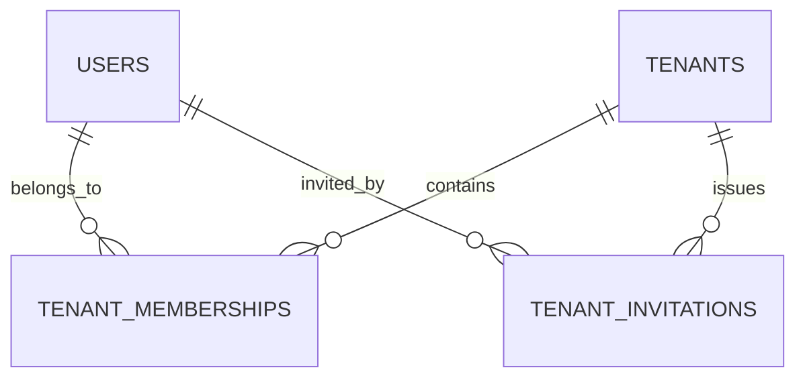
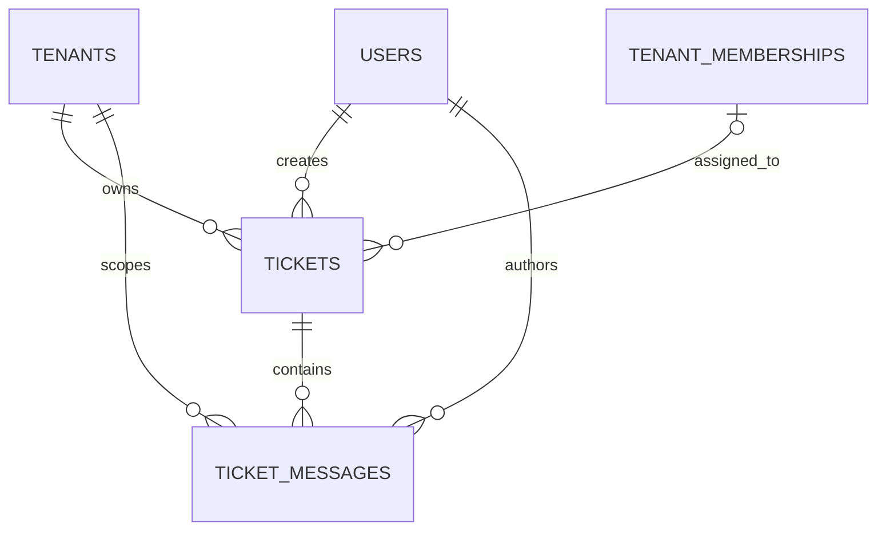
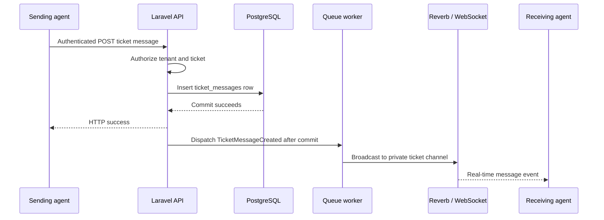

# SupportHub — Database Architecture

> **Database:** PostgreSQL  
> **Architecture:** Shared database, shared schema, tenant-owned rows  
> **Status:** Implemented schema + proposed MVP additions (clearly separated)  
> **Last reviewed:** 30 October 2026  
> **Related:** [System architecture](../architecture/README.md) · [Project README](../../README.md)

## Purpose and scope

SupportHub is an API-first, multi-tenant helpdesk portfolio project. This document describes **the existing relational schema**, its security and consistency requirements, and the **small remaining schema** for membership administration, ticket management, and internal real-time ticket chat.

**Laravel migrations are the source of truth for implemented columns and constraints.** Proposed tables and field names in this document must be checked against the actual implementation before migrations are written.

The MVP intentionally **does not** include subscription billing, customer accounts or a customer portal, a separate contacts table, public customer replies, attachments, analytics, or SLA automation. Staff enter requester details on tickets and exchange **internal** messages.

## Progress at a glance

| Area | Status | Database impact |
| --- | --- | --- |
| Laravel infrastructure | Implemented | Users, Sanctum tokens, sessions, cache, jobs and failed jobs |
| Tenants and memberships | Implemented | `tenants`, `tenant_memberships` |
| Email invitations | Implemented | `tenant_invitations`; one-time acceptance creates an active membership |
| Membership administration | **Next** | Reuse memberships for role changes, suspension/reactivation and removal; add migrations only if genuinely needed |
| Ticket management | Planned | `tickets` |
| Ticket conversations | Planned | `ticket_messages` |
| Real-time delivery | Planned | Laravel Reverb, broadcasting and queues; messages remain persisted in PostgreSQL |

## 1. Implemented schema

### Migrations

The existing database design records the following migrations:

| Migration | Tables created |
| --- | --- |
| `0001_01_01_000000_create_users_table` | `users`, `password_reset_tokens`, `sessions` |
| `0001_01_01_000001_create_cache_table` | `cache`, `cache_locks` |
| `0001_01_01_000002_create_jobs_table` | `jobs`, `job_batches`, `failed_jobs` |
| `2026_10_21_150708_create_personal_access_tokens_table` | `personal_access_tokens` |
| `2026_10_22_142059_create_tenants_table` | `tenants` |
| `2026_10_22_142100_create_tenant_memberships_table` | `tenant_memberships` |
| `2026_10_29_103436_create_tenant_invitations_table` | `tenant_invitations` |

Laravel also maintains the `migrations` table. Its session, cache, job and authentication tables are infrastructure, **not tenant-owned business records**.

### Current entity relationships

A **User** is a global login identity. A user may belong to several **Tenants**, with a different role or membership status in each one. Invitations target an **email address**; the recipient only becomes a member after authenticated acceptance.

### `users`

| Column | Purpose |
| --- | --- |
| `id` | Global user primary key |
| `name` | Display name |
| `email` | Unique login email |
| `email_verified_at` | Optional verification timestamp |
| `password` | Password hash |
| `remember_token` | Laravel authentication support |
| `created_at`, `updated_at` | Audit timestamps |

The user's role is **never stored on `users`**: it belongs to a tenant membership.

### `tenants`

| Column | Current rule |
| --- | --- |
| `id` | Primary key |
| `name` | Maximum 160 characters |
| `slug` | Maximum 120 characters; globally unique |
| `status` | `active`, `suspended`, or `archived`; defaults to `active` |
| `timezone` | Maximum 64 characters; defaults to `UTC` |
| `created_at`, `updated_at` | Timezone-aware timestamps |

The existing design documents a `tenants_status_check` constraint that rejects unsupported tenant statuses.

### `tenant_memberships`

| Column | Current rule |
| --- | --- |
| `id` | Primary key |
| `tenant_id` | Foreign key to `tenants`; restricted on delete |
| `user_id` | Foreign key to `users`; restricted on delete |
| `role` | Tenant role; existing schema documentation lists `owner`, `admin`, `agent` |
| `status` | `active` or `suspended` |
| `created_at`, `updated_at` | Timezone-aware timestamps |

Documented integrity rules:

- `UNIQUE (tenant_id, user_id)`: one membership per user in a company.
- `UNIQUE (tenant_id, id)`: available for tenant-safe composite foreign keys.
- Database checks for allowed role and status values; an index on `user_id`.
- Tenant creation and its initial **active Owner** membership occur in one transaction.

**Implementation distinction:** Owner/Agent behavior and active/suspended access checks are already used by the API. **Admin permissions, role-changing endpoints and membership lifecycle operations are the next milestone**; the database accepting a role value does not mean the HTTP workflow is implemented.

### `tenant_invitations`

| Column | Current rule |
| --- | --- |
| `id` | Primary key |
| `tenant_id` | Foreign key to `tenants`; cascades on tenant deletion |
| `email` | Invited email, trimmed and lowercased by the application |
| `role` | Role granted on acceptance; currently invitations create an `agent` membership |
| `token_hash` | Unique SHA-256 hash; **never** the plaintext token |
| `invited_by` | Foreign key to inviter `users.id`; restricted on delete |
| `expires_at` | Required timezone-aware timestamp |
| `accepted_at`, `revoked_at` | Nullable lifecycle timestamps |
| `created_at`, `updated_at` | Timezone-aware timestamps |

An index on `(tenant_id, email)` supports invitation lookup. That pair is **not unique**, so previous accepted, expired or revoked invitations can remain as history.

**Implemented invitation invariants:**

1. Invite only through an authorized active Owner; normalize the email.
2. Reject an existing tenant member or another **pending, unexpired, unrevoked** invitation for the same tenant/email.
3. Generate a cryptographically random token and store only its SHA-256 hash. The token expires after **seven days**.
4. Serialize invitation creation by locking the tenant row inside a transaction.
5. Queue the encrypted invitation email **after the transaction commits**.
6. On acceptance, lock the invitation, validate its token/state and the authenticated user's email, create an active membership, and set `accepted_at` **in one transaction**.
7. Reject token replay and preserve the unique `(tenant_id, user_id)` membership constraint.

The invitation creation and acceptance workflows have dedicated Pest feature tests. A previously observed duplicate-invitation test failure was corrected in the Action; a final full-suite rerun should be verified before marking the branch green.

## 2. Membership administration — next milestone

Membership operations primarily reuse `tenant_memberships`; no new role or status table is planned for the MVP.

| Operation | Intended database behavior |
| --- | --- |
| Change role | Update the membership's `role` after tenant-scoped authorization |
| Suspend member | Set `status = suspended`; preserve membership history |
| Reactivate member | Set `status = active` |
| Remove member | Delete the target membership only after authorization and integrity checks |
| Protect last Owner | Never leave a tenant without an **active Owner** |

For operations that could demote, suspend, or remove the last active Owner, **lock the tenant row in a transaction**, count active Owners under that lock, and apply the change atomically. All such write paths must follow the same locking convention. The exact authorization matrix for Owner/Admin/Agent will be defined with the member-management policies; do not infer it from the enum alone.

Security checks must reject cross-tenant membership IDs and suspended callers. If ticket assignments or messages reference membership records, review deletion behavior so removing staff does not accidentally destroy ticket history.

## 3. Planned MVP schema — tickets and internal messages

**Not yet migrated.** The tables and fields below are a proposed minimal design consistent with the current SupportHub roadmap.

### Proposed relationships

### `tickets` — proposed

| Column | Purpose / constraint |
| --- | --- |
| `id` | Primary key |
| `tenant_id` | Required FK to `tenants`; **every ticket belongs to one tenant** |
| `title` | Required short summary |
| `description` | Required problem description |
| `requester_name` | Customer name, stored directly on ticket |
| `requester_email` | Customer email, stored directly on ticket |
| `priority` | `low`, `medium`, `high` |
| `status` | `open`, `in_progress`, `resolved`, `closed` |
| `assigned_to` | Nullable staff user or membership reference; finalize FK before migration |
| `created_by` | Staff user reference; finalize FK before migration |
| `created_at`, `updated_at` | Timezone-aware timestamps |

**Key invariants:**

- Ticket queries, updates and nested route bindings always include the authorized `tenant_id`.
- An assigned Agent must have an **active membership in the ticket's tenant**. Never accept a user ID merely because that user exists globally.
- Keep tenant-safe relational constraints where feasible, e.g. a composite `(tenant_id, assigned_to)` reference to unique `(tenant_id, user_id)` in `tenant_memberships` **if assignment uses user IDs**.
- Enforce valid priority and status values in Laravel backed enums and, where practical, database check constraints.
- Suggested indexes (to validate against actual queries): `(tenant_id, status, created_at)`, `(tenant_id, assigned_to)`, and tenant-scoped pagination indexes.
- Preserve ticket history if the assigned Agent is later suspended or removed; the final FK deletion action must be chosen accordingly.

A separate `contacts` table, ticket event/audit table, attachment table, and customer authentication model are **not required** for this MVP.

### `ticket_messages` — proposed

| Column | Purpose / constraint |
| --- | --- |
| `id` | Primary key |
| `tenant_id` | Required tenant FK for explicit isolation |
| `ticket_id` | Required FK to a ticket in the **same tenant** |
| `user_id` | Authoring staff user ID; validate active membership at write time |
| `body` | Required internal message content |
| `created_at`, `updated_at` | Timezone-aware timestamps |

**Key invariants:**

- A message belongs to **exactly one ticket in the same tenant**. Prefer `(tenant_id, ticket_id)` referencing `tickets(tenant_id, id)` with a matching parent uniqueness constraint, if that composite FK is adopted.
- Only authorized **active tenant staff** can create messages, read message history, or subscribe to the ticket's private WebSocket channel.
- Message history is fetched through a paginated endpoint ordered by `(created_at, id)` to stabilize ordering for messages with identical timestamps.
- Indexing candidate: `(tenant_id, ticket_id, created_at, id)`.
- Messages are **internal staff conversation**, not customer-visible replies. Read receipts, typing indicators, reactions, and attachments are optional later work.
- Consider author preservation before implementing hard member deletion; historical messages must not disappear just because a staff account's access changes.

### Ticket lifecycle and assignment

A ticket is created by an authorized team member, may be assigned to an active Agent, and moves between the defined status values. Status transitions and role permissions belong to **Actions/Policies**, rather than relying solely on check constraints. Cross-tenant assignment and ticket/message relationships must be rejected even when the supplied IDs are individually valid.

## 4. Real-time chat and persistence

Real-time ticket chat is a **planned, required learning milestone** using Laravel Reverb, Broadcasting, Echo, private channels, and a queue worker.

**Database remains the source of truth.** WebSocket events are a delivery mechanism, not the canonical message store: clients reload missed history via REST after disconnecting. Only broadcast committed messages; do not expose messages from rolled-back transactions. Private-channel authorization is required independently of the message POST endpoint and must check active membership and ticket access.

The existing `jobs` and `failed_jobs` tables support the database-backed queue. Laravel Reverb does **not** require a separate `ticket_chats` or WebSocket-message persistence table for this design. Run the HTTP server, queue worker, and Reverb server as separate processes.

## 5. Tenant isolation and relational integrity

Every new tenant-owned table must follow these rules:

1. Store a required `tenant_id` unless the data is deliberately global or infrastructure-owned.
2. Authenticate the caller and authorize **active membership** in the target tenant. A URL parameter or submitted `tenant_id` is not proof of access.
3. Scope *all* reads, writes, nested route model bindings and queued jobs to the tenant.
4. Ensure assignment, ticket, message and author relationships cannot cross tenant boundaries; combine policy checks with appropriate foreign keys or composite foreign keys.
5. Enforce uniqueness and role/status value constraints at the database level where feasible.
6. Use transactions and consistent row-lock ordering for multi-write operations with concurrency-sensitive invariants.
7. Test outsider, suspended-member and cross-tenant read/write attempts for each protected feature, including channel subscription authorization.

A global Eloquent scope can reduce accidental omissions but is **not a substitute for authorization**.

## 6. PostgreSQL design conventions

- Prefer numeric primary keys for internal relations; any public ticket identifier can be decided in the Tickets module.
- Keep business timestamps timezone-aware and use UTC as the storage baseline.
- Use PHP backed enums with string columns for bounded states; use database check constraints for stable sets.
- Store secrets as one-way hashes; never persist plaintext invitation tokens or Sanctum credentials.
- Use `JSONB` only for bounded metadata when necessary, not as a replacement for relational structure.
- Add supporting indexes for actual filtering, pagination and joining patterns. PostgreSQL does **not** automatically create indexes for all referencing foreign keys.
- Use deliberate FK delete actions that preserve tickets and conversation history; avoid broad cascading deletes for durable records.
- Changes to deployed/shared tables must use new migrations rather than silently rewriting old ones.
- Keep the schema small; don't add new modules, tables or abstractions without a use case from the agreed MVP.

## 7. Tests and migration workflow

Use Pest with a **separate isolated PostgreSQL test database** (not the local development database). Database-facing tests should verify PostgreSQL-specific constraints and transaction behavior, rather than relying only on mocks.

Important coverage includes:

- Membership uniqueness, valid statuses/roles, tenant isolation, and last-active-Owner protection.
- Invitation expiry, replay prevention, wrong recipient, existing member, duplicate pending invitations, and rollback behavior.
- Ticket and message foreign keys, cross-tenant IDs, valid assignments, state transitions and paginated message history.
- Message persistence when broadcasting is queued, and **no event for rolled-back writes**.
- Private broadcast channel authorization for active members versus outsiders or suspended users.

When starting a new module: inspect the actual migrations, confirm naming and FK choices, add the minimum schema, add feature tests, and only then update the **planned** sections here to **implemented**. Keep migration filenames and indexes synchronized with repository code.

## 8. Remaining delivery sequence

1. **Tenancy:** Implement Admin permissions, role changes, suspend/reactivate/remove, last-Owner protection, and tests.
2. **Tickets:** Create `tickets` migration/model, authorization, tenant-scoped CRUD, assignments and status/priority changes.
3. **Messages:** Create `ticket_messages`, internal POST/history endpoints, author checks and pagination.
4. **Real-time:** Add Reverb/Broadcasting/Echo, queued events after commit, private subscription authorization and two-client verification.
5. **Portfolio completion:** Run full tests, document API, add CI and deployment instructions as appropriate.

**Out of scope for the agreed MVP:** Stripe billing, subscriptions, invoices, contacts/customer accounts, public chat, attachments, SLAs, analytics dashboards, full frontend, and presence/typing indicators.
